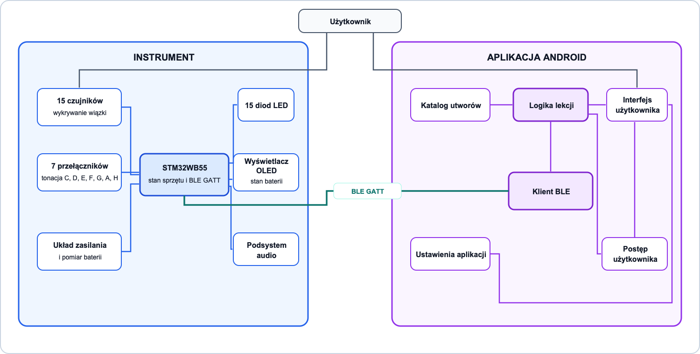
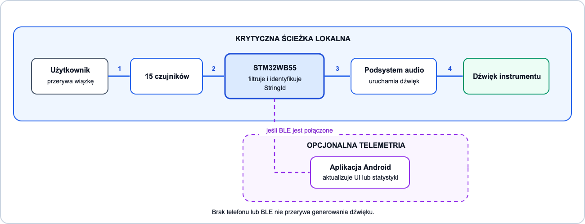
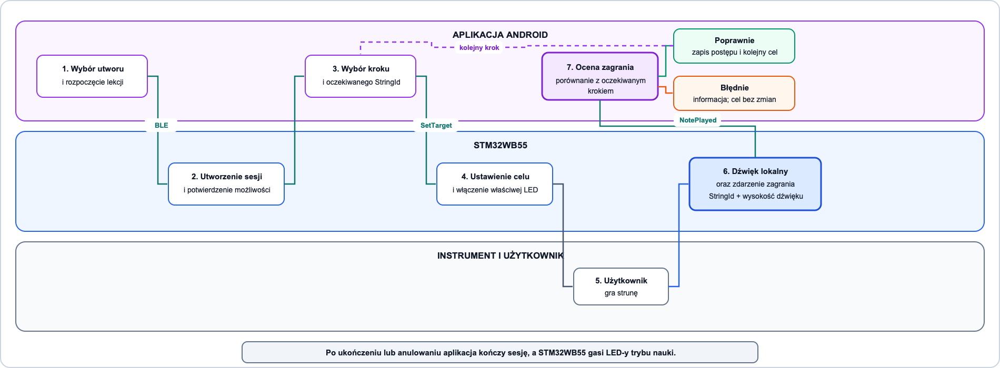

# ADR 001: Granice odpowiedzialności STM32WB55 i aplikacji mobilnej

* **Stan:** Przyjęty
* **Data:** 2026-11-01
* **Osoby decyzyjne:** Alicja Kowalska, Emilia Bonk

## Kontekst

System HARFA składa się z fizycznego instrumentu sterowanego przez STM32WB55 oraz
aplikacji mobilnej Android wspomagającej naukę gry. Instrument ma działać również bez
telefonu, dlatego aplikacja nie może znajdować się w krytycznej ścieżce wykrywania
struny ani generowania dźwięku.

Granice odpowiedzialności muszą zapobiegać dublowaniu logiki pomiędzy firmware'em
a aplikacją. Decyzje dotyczące liczby strun, mikrokontrolera i toru audio są opisane
odpowiednio w [ADR 002](002-nr-of-strings.md), [ADR 003](003-mcu-and-ble-choice.md)
i [ADR 004](004-audio-architecture.md).

## Rozważane alternatywy

### Opcja A: STM32WB55 obsługuje czas rzeczywisty, aplikacja obsługuje funkcje edukacyjne

**Zalety:**

* wykrywanie struny i uruchomienie dźwięku nie zależą od telefonu ani połączenia BLE,
* instrument może działać samodzielnie,
* aplikacja może rozwijać katalog utworów, lekcje i postęp bez zwiększania złożoności
  firmware'u,
* odpowiedzialność za stan sprzętu i dane użytkownika jest jednoznaczna.

**Wady:**

* konieczne jest zaprojektowanie wersjonowanego, dwukierunkowego protokołu BLE,
* tryb nauki wymaga synchronizacji sesji pomiędzy aplikacją i instrumentem.

### Opcja B: Aplikacja mobilna obsługuje również czas rzeczywisty

**Zalety:**

* prostsza centralizacja logiki w jednym miejscu,
* aplikacja może bezpośrednio decydować o reakcji na każde zdarzenie.

**Wady:**

* opóźnienie i utrata pakietów BLE wpływałyby na dźwięk instrumentu,
* harfa nie działałaby poprawnie bez telefonu,
* telefon znalazłby się w krytycznej ścieżce działania urządzenia.

### Opcja C: STM32WB55 przechowuje i wykonuje logikę lekcji

**Zalety:**

* krótsza ścieżka od zdarzenia struny do reakcji sprzętu,
* mniejsza liczba komunikatów potrzebnych w trakcie lekcji.

**Wady:**

* firmware musiałby przechowywać katalog utworów i logikę postępu,
* aktualizacja treści lekcji wymagałaby zmian po stronie instrumentu,
* logika aplikacji i firmware'u mogłaby się dublować.

### Zachowanie po utracie połączenia BLE

Rozważono trzy warianty zachowania aktywnej lekcji:

* **Opcja A - pauza i bezpieczny powrót do zwykłej gry:** aplikacja zachowuje ostatni
  potwierdzony krok, STM32WB55 gasi LED-y trybu nauki i pozostaje gotowy do zwykłej gry;
* **Opcja B - krótkie oczekiwanie:** STM32WB55 utrzymuje ostatnią LED przez ustalony
  czas, a następnie przechodzi do bezpiecznego stanu;
* **Opcja C - natychmiastowe zakończenie:** sesja lekcji zostaje zakończona i musi
  zostać uruchomiona ponownie ręcznie.

## Decyzja

### Decyzja dotycząca granic odpowiedzialności

Wybrano **Opcję A z alternatyw architektury**: STM32WB55 odpowiada za czas rzeczywisty
instrumentu, a aplikacja mobilna odpowiada za katalog, lekcje, postęp, ustawienia
i prezentację.

STM32WB55 jest właścicielem:

* odczytu i filtrowania sygnałów z 15 czujników,
* identyfikacji struny przez stabilny `StringId`,
* lokalnego uruchomienia dźwięku instrumentu,
* fizycznego stanu 15 diod LED,
* odczytu 7 przełączników tonacji dla dźwięków C, D, E, F, G, A i H we wszystkich oktawach,
* stanu sprzętu, baterii i błędów urządzenia,
* wyświetlania stanu baterii na wyświetlaczu OLED,
* serwera BLE GATT i raportowanych zdarzeń instrumentu.

Aplikacja mobilna jest właścicielem:

* katalogu utworów i sekwencji nut,
* rozpoczęcia, pauzy i zakończenia lekcji,
* indeksu aktualnego kroku lekcji,
* oceny, czy zagrano oczekiwaną strunę,
* postępu użytkownika,
* ustawień aplikacji i interfejsu,
* klienta BLE GATT oraz prezentacji stanu połączenia.

### Decyzja dotycząca utraty połączenia BLE

Wybrano **Opcję A z alternatyw zachowania po utracie BLE - pauzę i bezpieczny powrót
do zwykłej gry**:

1. Aplikacja zachowuje ostatni potwierdzony krok i oznacza lekcję jako wstrzymaną.
2. STM32WB55 kończy aktywną sesję lekcji i gasi LED-y trybu nauki.
3. Instrument nadal wykrywa struny i generuje dźwięk bez udziału aplikacji.
4. Po ponownym połączeniu aplikacja tworzy nową sesję, uzgadnia możliwości instrumentu
   i ponownie wysyła ostatni nieukończony krok.

Zatrzymanie całego instrumentu po utracie BLE jest niedopuszczalne, ponieważ narusza
wymaganie pracy bez telefonu.

### Diagram odpowiedzialności

[Wersja SVG](diagrams/system-responsibilities.svg) · [Edytowalne źródło draw.io](diagrams/system-responsibilities.drawio)

### Macierz odpowiedzialności

| Obszar | STM32WB55 | Aplikacja mobilna | Źródło prawdy |
|---|---|---|---|
| Odczyt czujników | Odczytuje, filtruje i wykrywa przerwanie wiązki | Nie odczytuje czujników bezpośrednio | STM32WB55 |
| Identyfikacja struny | Przypisuje zdarzenie do stabilnego `StringId` | Odbiera gotowe zdarzenie | STM32WB55 |
| Mapowanie struny na dźwięk | Przechowuje aktualne mapowanie `StringId` na wysokość dźwięku | Używa otrzymanego mapowania do dopasowania kroków lekcji | STM32WB55 |
| Generowanie dźwięku | Uruchamia dźwięk lokalnie po wykryciu struny | Nie uczestniczy w ścieżce generowania dźwięku instrumentu | STM32WB55 |
| Fizyczne diody LED | Włącza i wyłącza LED oraz raportuje zastosowany stan | Wysyła żądanie podświetlenia struny wynikające z kroku lekcji | STM32WB55 dla stanu fizycznego, aplikacja dla celu lekcji |
| Stan sprzętu | Monitoruje baterię, czujniki, podsystem audio i błędy urządzenia oraz wyświetla stan baterii na OLED | Prezentuje otrzymany stan użytkownikowi | STM32WB55 |
| Połączenie BLE | Działa jako serwer GATT i publikuje możliwości instrumentu | Działa jako klient GATT, inicjuje połączenie i prezentuje jego stan | Każda strona dla swojego stanu lokalnego |
| Katalog utworów | Nie przechowuje katalogu | Przechowuje i prezentuje utwory oraz ich sekwencje nut | Aplikacja |
| Przebieg lekcji | Wykonuje komendy sprzętowe dotyczące aktualnego celu | Rozpoczyna, pauzuje i kończy lekcję oraz wybiera kolejny krok | Aplikacja |
| Ocena zagrania | Raportuje faktycznie zagraną strunę | Porównuje zdarzenie z oczekiwanym krokiem lekcji | Aplikacja |
| Postęp użytkownika | Nie przechowuje historii użytkownika | Zapisuje ukończone kroki, utwory i statystyki | Aplikacja |
| Ustawienia interfejsu | Nie zna języka ani motywu aplikacji | Przechowuje język, motyw i ustawienia prezentacji | Aplikacja |
| Ustawienia instrumentu | Odczytuje 7 przełączników odpowiadających tonom C, D, E, F, G, A i H oraz stosuje wybraną wartość we wszystkich oktawach | Nie steruje lokalnymi przełącznikami; może prezentować aktywną wartość, jeśli protokół ją udostępnia | STM32WB55 |

### Przepływ zwykłej gry

[Wersja SVG](diagrams/gameplay-flow.svg) · [Edytowalne źródło draw.io](diagrams/gameplay-flow.drawio)

Aplikacja jest opcjonalna w tym przepływie. Awaria aplikacji albo BLE może spowodować
brak aktualizacji UI, ale nie może wpłynąć na dźwięk instrumentu.

### Przepływ trybu nauki

[Wersja SVG](diagrams/learning-flow.svg) · [Edytowalne źródło draw.io](diagrams/learning-flow.drawio)

Aplikacja jest jedynym właścicielem indeksu aktualnego kroku i oceny poprawności.
STM32WB55 nie przechowuje utworu ani nie duplikuje logiki przechodzenia między krokami.

## Konsekwencje

* Krytyczna ścieżka gry przebiega lokalnie:
  `przerwanie wiązki -> STM32WB55 -> identyfikacja struny -> uruchomienie dźwięku`.
* Aplikacja nie pośredniczy między czujnikiem a dźwiękiem i nie może być wymagana do
  zwykłej gry.
* STM32WB55 nie przechowuje katalogu utworów ani postępu użytkownika.
* Protokół BLE musi obsługiwać handshake, wersję protokołu, możliwości instrumentu,
  mapowanie `StringId`, zdarzenia zagrania, komendy LED, identyfikator sesji,
  potwierdzenia i błędy.
* Komendy lekcji z poprzedniej sesji nie mogą zmienić stanu LED po ponownym połączeniu.
* Aplikacja nie zapisuje kroku jako ukończonego bez zdarzenia potwierdzonego przez
  STM32WB55.
* Połączenie BLE może rozszerzać działanie instrumentu, ale nie może być wymagane do gry.
* Szczegółowa decyzja dotycząca implementacji toru audio obowiązuje zgodnie z
  [ADR 004](004-audio-architecture.md) i nie jest powielana w tym dokumencie.
