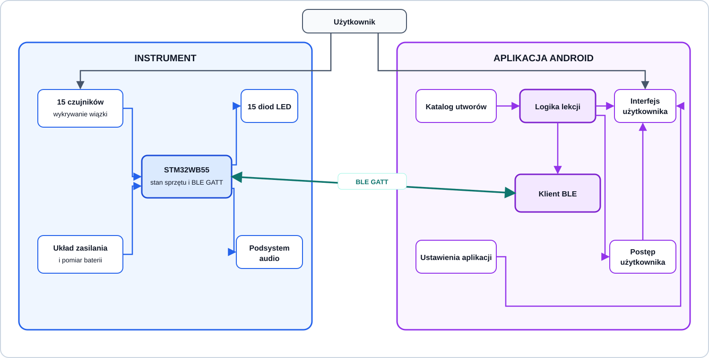
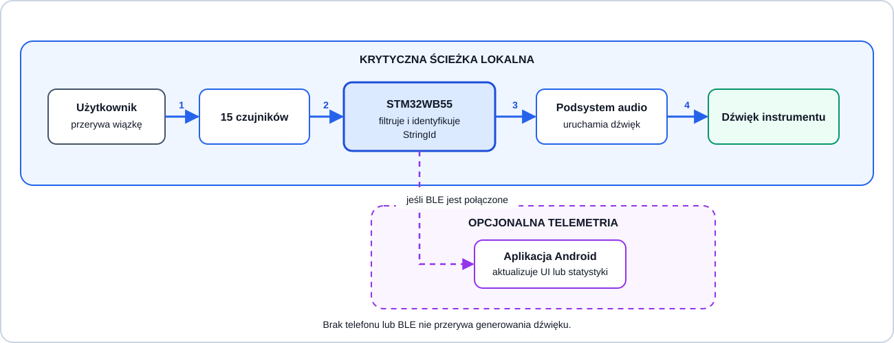
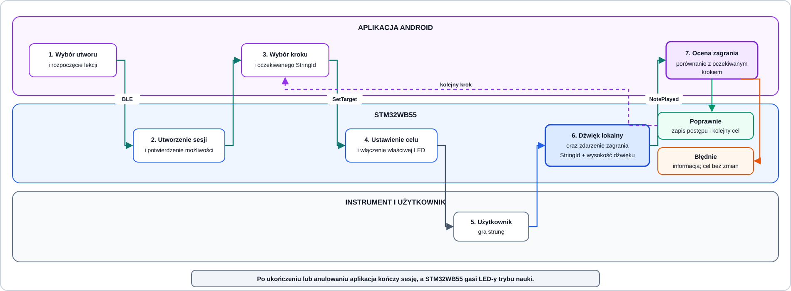

# Granice odpowiedzialności STM32WB55 i aplikacji mobilnej

**Status:** zaakceptowane granice systemu, dwie decyzje implementacyjne pozostają otwarte
**Data:** 2026-10-31

## Kontekst

System HARFA składa się z fizycznego instrumentu sterowanego przez STM32WB55 oraz
aplikacji mobilnej Android wspomagającej naukę gry. Instrument ma działać również bez
telefonu, dlatego aplikacja nie może znajdować się w krytycznej ścieżce wykrywania
struny ani generowania dźwięku.

## Zaakceptowane decyzje

- instrument ma 15 strun, 15 czujników i 15 odpowiadających im diod LED,
- mikrokontrolerem jest STM32WB55 korzystający z BLE,
- instrument wykrywa struny i generuje dźwięk bez połączenia z aplikacją,
- aplikacja jest właścicielem katalogu utworów, przebiegu lekcji i postępu użytkownika,
- STM32WB55 jest właścicielem stanu sprzętu i zdarzeń pochodzących z instrumentu,
- aplikacja ocenia, czy zagrano prawidłową strunę, i wybiera kolejny krok lekcji,
- sposób realizacji toru audio oraz zachowanie po utracie połączenia podczas lekcji
  pozostają decyzjami otwartymi.

## Główna zasada architektoniczna

Krytyczna ścieżka gry przebiega lokalnie w instrumencie:

```text
przerwanie wiązki -> STM32WB55 -> identyfikacja struny -> uruchomienie dźwięku
```

BLE i aplikacja mobilna służą do sterowania funkcjami edukacyjnymi, prezentacji
informacji i zapisywania postępu. Opóźnienie, brak telefonu lub zerwane połączenie BLE
nie mogą blokować wykrywania strun ani odtwarzania dźwięku.

## Diagram odpowiedzialności



[Edytowalne źródło draw.io](diagrams/system-responsibilities.drawio)

## Macierz odpowiedzialności

| Obszar | STM32WB55 | Aplikacja mobilna | Źródło prawdy |
|---|---|---|---|
| Odczyt czujników | Odczytuje, filtruje i wykrywa przerwanie wiązki | Nie odczytuje czujników bezpośrednio | STM32WB55 |
| Identyfikacja struny | Przypisuje zdarzenie do stabilnego `StringId` | Odbiera gotowe zdarzenie | STM32WB55 |
| Mapowanie struny na dźwięk | Przechowuje aktualne mapowanie `StringId` na wysokość dźwięku i udostępnia je podczas zestawiania sesji | Używa otrzymanego mapowania do dopasowania kroków lekcji | STM32WB55 |
| Generowanie dźwięku | Uruchamia dźwięk lokalnie po wykryciu struny | Nie uczestniczy w ścieżce generowania dźwięku instrumentu | STM32WB55 |
| Fizyczne diody LED | Włącza i wyłącza LED oraz raportuje zastosowany stan | Wysyła żądanie podświetlenia struny wynikające z kroku lekcji | STM32WB55 dla stanu fizycznego, aplikacja dla celu lekcji |
| Stan sprzętu | Monitoruje baterię, czujniki, podsystem audio i błędy urządzenia | Prezentuje otrzymany stan użytkownikowi | STM32WB55 |
| Połączenie BLE | Działa jako serwer GATT i publikuje możliwości instrumentu | Działa jako klient GATT, inicjuje połączenie i prezentuje jego stan | Każda strona dla swojego stanu lokalnego |
| Katalog utworów | Nie przechowuje katalogu | Przechowuje i prezentuje utwory oraz ich sekwencje nut | Aplikacja |
| Przebieg lekcji | Wykonuje komendy sprzętowe dotyczące aktualnego celu | Rozpoczyna, pauzuje i kończy lekcję oraz wybiera kolejny krok | Aplikacja |
| Ocena zagrania | Raportuje faktycznie zagraną strunę | Porównuje zdarzenie z oczekiwanym krokiem lekcji | Aplikacja |
| Postęp użytkownika | Nie przechowuje historii użytkownika | Zapisuje ukończone kroki, utwory i statystyki | Aplikacja |
| Ustawienia interfejsu | Nie zna języka ani motywu aplikacji | Przechowuje język, motyw i ustawienia prezentacji | Aplikacja |
| Ustawienia instrumentu | Stosuje ustawienie i raportuje faktycznie aktywną wartość | Może wysłać żądanie zmiany, jeżeli dana funkcja zostanie udostępniona | STM32WB55 dla aktywnego stanu |

## Dane wymieniane między systemami

Dokładny format i wersjonowanie wiadomości zostaną zdefiniowane w osobnym protokole.
Granica odpowiedzialności wymaga jednak co najmniej następujących grup komunikatów:

### Aplikacja do STM32WB55

- rozpoczęcie i zakończenie sesji lekcji,
- ustawienie aktualnej struny docelowej,
- wyczyszczenie LED-ów trybu nauki,
- opcjonalne żądania zmiany ustawień instrumentu,
- zapytanie o możliwości i aktualny stan instrumentu.

### STM32WB55 do aplikacji

- identyfikacja urządzenia, wersja firmware i obsługiwana wersja protokołu,
- liczba strun oraz mapowanie `StringId` na wysokość dźwięku,
- zdarzenie zagrania zawierające co najmniej `StringId` i wysokość dźwięku,
- stan baterii i gotowość podsystemów,
- potwierdzenie albo odrzucenie wykonania komendy,
- kod błędu urządzenia lub komunikacji.

Komendy lekcji powinny zawierać identyfikator sesji. Zapobiega to wykonaniu opóźnionej
komendy po ponownym połączeniu lub po rozpoczęciu innej lekcji.

## Przepływ zwykłej gry



[Edytowalne źródło draw.io](diagrams/gameplay-flow.drawio)

W tym przepływie aplikacja jest opcjonalna. Awaria aplikacji albo BLE może spowodować
brak aktualizacji UI, ale nie może wpłynąć na dźwięk instrumentu.

## Przepływ trybu nauki



[Edytowalne źródło draw.io](diagrams/learning-flow.drawio)

Aplikacja jest jedynym właścicielem indeksu aktualnego kroku i oceny poprawności.
STM32WB55 nie przechowuje utworu ani nie duplikuje logiki przechodzenia między krokami.

## Praca bez aplikacji

Bez aktywnego połączenia BLE instrument:

- nadal wykrywa wszystkie struny,
- nadal generuje przypisane dźwięki,
- nie uruchamia trybu nauki,
- nie zapisuje postępu użytkownika,
- nie wymaga katalogu utworów z telefonu.

## Otwarte decyzje

### Tor audio

Niezależnie od wybranego wariantu STM32WB55 pozostaje odpowiedzialny za uruchomienie
dźwięku. Telefon nie może być źródłem dźwięku instrumentu.

| Wariant | Opis | Zalety | Ryzyka i elementy do sprawdzenia |
|---|---|---|---|
| Próbki WAV, I²S i MAX98357A | STM32WB55 wybiera próbkę i przesyła dźwięk cyfrowo do wzmacniacza | Prosty, powtarzalny dźwięk; łatwe przypisanie próbek do strun | Pamięć na próbki, miksowanie wielu dźwięków, polifonia i wydajność STM32WB55 |
| ADAU1701 i TPA3110/TPA3116 | STM32WB55 wyzwala dźwięk realizowany przez zewnętrzny DSP, a tor analogowy jest wzmacniany przez TPA | Odciążenie mikrokontrolera i możliwość kształtowania brzmienia w DSP | Większa złożoność sprzętu i narzędzi, trudniejsze użycie gotowych próbek |

Przed wyborem należy wykonać krótki prototyp obu rozważanych wariantów i porównać:
opóźnienie od czujnika do dźwięku, jakość brzmienia, obsługiwaną polifonię, zużycie
pamięci, pobór energii oraz złożoność implementacji.

### Utrata połączenia podczas lekcji

Każdy wariant musi zachować lokalne generowanie dźwięku przez instrument oraz
uniemożliwić pozostawienie nieaktualnej diody włączonej bezterminowo.

| Wariant | Zachowanie | Zalety | Wady |
|---|---|---|---|
| A. Pauza i bezpieczny powrót do zwykłej gry — rekomendowany | Aplikacja zachowuje ostatni potwierdzony krok. STM32WB55 po utracie sesji gasi LED-y trybu nauki i pozostaje w zwykłym trybie gry. Po ponownym połączeniu aplikacja tworzy nową sesję i ponownie wysyła krok. | Bezpieczny stan sprzętu, zachowanie postępu i możliwość płynnego wznowienia | Wymaga obsługi ponownego zestawienia sesji |
| B. Krótki okres oczekiwania | STM32WB55 zachowuje aktywną LED przez ustalony czas, np. 5–10 sekund. Jeśli połączenie nie wróci, przechodzi do wariantu A. | Krótkie zakłócenie BLE może być niewidoczne dla użytkownika | Więcej stanów i ryzyko chwilowo nieaktualnej wskazówki |
| C. Natychmiastowe zakończenie lekcji | STM32WB55 gasi LED-y, a aplikacja oznacza sesję jako zakończoną. Użytkownik rozpoczyna lekcję ponownie ręcznie. | Najprostsza implementacja | Utrata bieżącej sesji i gorsze doświadczenie użytkownika |

Zatrzymanie całego instrumentu po utracie BLE nie jest dopuszczalnym wariantem,
ponieważ narusza zaakceptowane wymaganie pracy bez telefonu.

## Niezmienniki systemu

- aplikacja nie pośredniczy między czujnikiem a dźwiękiem,
- STM32WB55 nie przechowuje katalogu utworów ani postępu użytkownika,
- aplikacja nie zapisuje kroku jako ukończonego bez zdarzenia potwierdzonego przez STM32WB55,
- komenda z poprzedniej sesji lekcji nie może zmienić stanu LED w nowej sesji,
- stan fizycznego instrumentu raportowany przez STM32WB55 ma pierwszeństwo przed stanem
  przewidywanym przez aplikację,
- połączenie BLE może rozszerzać działanie instrumentu, ale nie może być wymagane do gry.

## Kryteria zamknięcia decyzji otwartych

- wybrano i udokumentowano tor audio po wykonaniu prototypu,
- wybrano jeden wariant zachowania po utracie połączenia,
- wybrane warianty zostały przeniesione do wymagań protokołu i testów integracyjnych.
