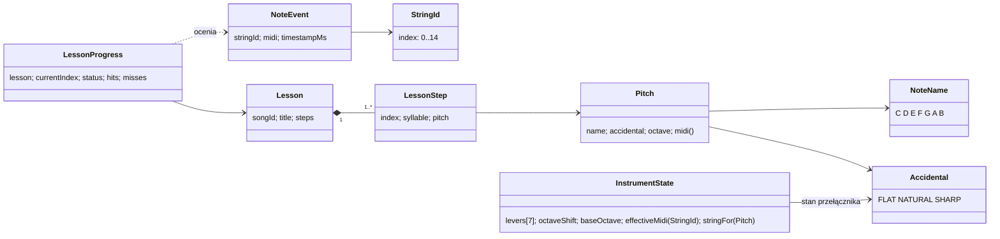

# Model domenowy aplikacji: lekcje, nuty i zdarzenia instrumentu

* **Wersja:** 1.0
* **Data:** 2026-11-04
* **Powiązane dokumenty:** [ADR 009](adr/009-domain-model.md), [ADR 008 – architektura warstwowa](adr/008-mobile-app-layered-architecture.md), [Mapowanie strun](note-mapping.md), [Protokół BLE](protocol/ble-protocol.md), [ADR 001](adr/001-system-responsibilities.md)

Dokument definiuje pojęcia domenowe, którymi posługuje się aplikacja mobilna w trybie nauki. Zastępuje on operowanie surowymi napisami (np. `"G#4"`) jednoznacznymi typami. Model jest **niezależny od Androida, Rooma i warstwy BLE**: można go w całości przetestować testami jednostkowymi.

Model należy do warstwy `domain` z [ADR 008](adr/008-mobile-app-layered-architecture.md):

| Warstwa | Odpowiedzialność w trybie nauki |
| :--- | :--- |
| `domain` | Typy z tego dokumentu, walidacja katalogu (§6), ocena kroku (`LessonProgress`) i przygotowanie lekcji z utworu. |
| `device` | Odwzorowanie ramek protokołu na `NoteEvent` i `InstrumentState` (§7). `InstrumentRepository` udostępnia strumienie tych typów. |
| `data` | Odczyt katalogu (`songs.json`, Room) jako model `Song` z surowymi nutami. Bez interpretowania nut. |
| `presentation` | Przechowywanie bieżącego `LessonProgress`, wyświetlanie kroków i błędów walidacji. |

Notacja dźwięków jest anglosaska (`C D E F G A B`), zgodnie z [note-mapping](note-mapping.md).

---

## 1. Przegląd

Najważniejsza zasada: **`StringId` (gdzie zagrano) i `Pitch` (jaki dźwięk) to różne pojęcia.** Ta sama struna daje różne dźwięki zależnie od przełączników i transpozycji. Do jednego dźwięku może też prowadzić więcej niż jedna konfiguracja.

---

## 2. Typy wartości

### 2.1 `StringId`

Indeks fizycznej struny `0..14` (tabela §2 w note-mapping). Nie niesie informacji o wysokości dźwięku.

- Wartość spoza `0..14` **NIE MOŻE** zostać utworzona. Konstrukcja z niezweryfikowanego źródła (np. z ramki BLE) zwraca „brak wartości” zamiast zgłaszać wyjątek.
- Liczba strun: `15`.

### 2.2 `NoteName`

Nazwa stopnia gamy wraz z odległością od C w półtonach i indeksem przełącznika (note-mapping §3):

| `NoteName` | Półtony od C | Indeks przełącznika (`lever[i]`) |
| :---: | :---: | :---: |
| C | 0 | 0 |
| D | 2 | 1 |
| E | 4 | 2 |
| F | 5 | 3 |
| G | 7 | 4 |
| A | 9 | 5 |
| B | 11 | 6 |

### 2.3 `Accidental`

Znak chromatyczny: `FLAT` (−1, zapis `b`), `NATURAL` (0, brak znaku), `SHARP` (+1, zapis `#`).
Ten sam typ opisuje **stan przełącznika** (`LeverOffset ∈ {−1, 0, +1}` z note-mapping §3).

### 2.4 `Pitch`

Wysokość dźwięku: `NoteName` + `Accidental` + oktawa.

- Numer MIDI: `midi = (octave + 1) × 12 + półtony(NoteName) + offset(Accidental)`.
  Wynik zgadza się z tabelami note-mapping: `C2 = 36`, `C4 = 60`, `B0 = 23`, `C#5 = 73`.
- Zapis tekstowy: `<litera><znak?><oktawa>`, np. `G4`, `G#4`, `Bb3`.
- **Równość** porównuje pisownię: `G4 ≠ G#4 ≠ G5`, a `G#4 ≠ Ab4`.
- **Enharmonia**: `G#4` i `Ab4` mają to samo `midi` (68). Rozpoznaje je osobna operacja „czy enharmoniczne”.
- `Pitch` z numeru MIDI (np. ze zdarzenia harfy) jest zapisywany **z krzyżykami**, zgodnie z nazwami plików w note-mapping §5 (`cs`, `ds`, `fs`, `gs`, `as`).

#### Parsowanie zapisu tekstowego

Parsowanie **nigdy nie zgłasza wyjątku**. Zwraca poprawny `Pitch` albo błąd z powodem:

| Wejście | Wynik |
| :--- | :--- |
| `null`, `""`, `"   "` | błąd `EMPTY` |
| `"G4"`, `" g4 "` | `G4` (białe znaki obcinane, litera bez względu na wielkość) |
| `"G#4"`, `"Gb4"` | `G#4`, `Gb4` |
| `"H4"`, `"G##4"`, `"G"`, `"4G"`, `"G#"`, `"G10"` | błąd `MALFORMED` |

Gramatyka: litera `A–G`, opcjonalnie jeden znak `#` lub `b`, oktawa jedną cyfrą `0..8`.

### 2.5 Zakres instrumentu

Zakres osiągalny na harfie to `B0..C#5`, czyli MIDI `23..73` (note-mapping §5): bazowe `C2..C4`, rozszerzone przełącznikami ±1 i transpozycją ±12. Dźwięk spoza tego zakresu jest **niegrywalny** przy każdym ustawieniu instrumentu.

---

## 3. Stan instrumentu

### 3.1 `InstrumentState`

Aktualne strojenie, którego źródłem prawdy jest harfa (ADR 001). Aplikacja odtwarza je z ramki `CONFIG_STATE` (protokół §4.8).

| Pole | Typ | Znaczenie |
| :--- | :--- | :--- |
| `levers` | 7 × `Accidental` | Stan przełączników dla `C D E F G A B`. |
| `octaveShift` | `−1`, `0`, `+1` | Transpozycja oktawowa. |
| `baseOctave` | liczba | Oktawa najniższej struny (dla obecnej konstrukcji: `2`). |

Stan domyślny, obowiązujący przed pierwszym `CONFIG_STATE`: wszystkie przełączniki `NATURAL`, `octaveShift = 0`, `baseOctave = 2`.

### 3.2 Operacje

- **`effectiveMidi(StringId)`**: wzór z note-mapping §4:
  `BaseMIDI[id] + offset(levers[Step(id)]) + octaveShift × 12`.
- **`stringFor(Pitch)`**: struna, która przy obecnym strojeniu wyda dany dźwięk (porównanie po `midi`). Zwraca „brak” w dwóch przypadkach: dźwięk jest poza zakresem albo jest w zakresie, ale wymaga innej pozycji przełącznika lub transpozycji. Aplikacja może wtedy podpowiedzieć użytkownikowi zmianę ustawienia. Wynik służy też do wyznaczenia maski LED w `LESSON_STEP`.

Przykłady:

| Stan | Zapytanie | Wynik |
| :--- | :--- | :--- |
| domyślny | `effectiveMidi(5)` | `45` (A2) |
| `lever[A] = SHARP` | `effectiveMidi(5)` | `46` (A#2), jak w protokole §9.3 |
| `octaveShift = +1` | `effectiveMidi(11)` | `67` (G4) |
| domyślny | `stringFor(G4)` | brak (wymaga transpozycji) |
| `octaveShift = +1` | `stringFor(G4)` | `StringId(11)` |

---

## 4. Zdarzenia instrumentu

### 4.1 `NoteEvent`

Domenowa postać zagrania struny, tworzona z ramki `STRING_EVENT` (protokół §4.7).

| Pole | Znaczenie |
| :--- | :--- |
| `stringId` | `StringId` zagranej struny. |
| `midi` | Efektywny numer MIDI podany przez harfę. **Wartość autorytatywna**: aplikacja jej nie przelicza ani nie nadpisuje. |
| `timestampMs` | Znacznik czasu harfy (mod 65 536), wyłącznie do liczenia odstępów. |
| `pitch` *(pochodne)* | `Pitch` z `midi`, zapisany z krzyżykami. Służy do prezentacji. |

Ramka, z której nie da się utworzyć poprawnego `NoteEvent` (np. `string_id > 14`), jest odrzucana i logowana zgodnie z protokołem §6.2. Nie powoduje awarii.

### 4.2 Źródła zdarzeń

Tryb nauki reaguje **wyłącznie** na `NoteEvent`. Stary format mocka (pojedyncza litera, np. `"F\n"` przez SPP) nie niesie oktawy ani numeru struny, więc nie jest przekładany na `NoteEvent`. Do czasu przejścia aplikacji i mocka na BLE (ADR 007) tryb nauki nie reaguje na stary mock.

---

## 5. Lekcja

### 5.1 `Lesson` i `LessonStep`

- `Lesson` to zweryfikowana lekcja utworzona z utworu z katalogu: `songId`, `title` i **niepusta** lista kroków.
- `LessonStep` to jeden krok: `index` (pozycja w lekcji), `syllable` (tekst do wyświetlenia) i oczekiwany `pitch`.
- Krok jest trafiony, gdy `NoteEvent.midi == step.pitch.midi`. Porównanie po MIDI oznacza, że enharmoniczny zapis w katalogu (`Ab4` lub `G#4`) daje ten sam wynik. Natomiast `G4`, `G#4` i `G5` są różnymi krokami.

`Lesson` może powstać **tylko** w wyniku walidacji katalogu (§6). Nie da się utworzyć lekcji z niepoprawnymi danymi.

### 5.2 `LessonProgress`

Niemutowalny stan przebiegu lekcji, którego właścicielem jest aplikacja (ADR 001).

| Pole | Znaczenie |
| :--- | :--- |
| `lesson` | Lekcja, której dotyczy postęp. |
| `currentIndex` | Indeks oczekiwanego kroku. |
| `status` | `IN_PROGRESS`, `PAUSED` albo `COMPLETED`. |
| `hits`, `misses` | Liczba trafień i pomyłek. |

Każde zdarzenie daje nowy stan oraz wynik kroku, który odpowiada `LESSON_RESULT` z protokołu §4.10:

| Status | Zdarzenie | Wynik | Nowy stan |
| :--- | :--- | :--- | :--- |
| `IN_PROGRESS` | zgodne `midi`, nie ostatni krok | `HIT` | `currentIndex + 1`, `hits + 1` |
| `IN_PROGRESS` | zgodne `midi`, ostatni krok | `COMPLETE` | `COMPLETED`, `hits + 1` |
| `IN_PROGRESS` | niezgodne `midi` | `MISS` | ten sam krok, `misses + 1` |
| `PAUSED` / `COMPLETED` | dowolne | `IGNORED` | bez zmian |

`PAUSED` realizuje zachowanie po utracie BLE z ADR 001: zachowany jest ostatni potwierdzony krok, a wznowienie wraca do `IN_PROGRESS` od tego samego `currentIndex`.

---

## 6. Walidacja katalogu

Utwory w katalogu (`songs.json`, baza Room) zawierają surowe pary `syllable` i `note`. Są to dane wejściowe, a nie model domenowy. Katalog nie przechowuje danych wyliczanych z nuty, takich jak numer struny, stopień czy MIDI ([ADR 009](adr/009-domain-model.md)).

Walidator przyjmuje identyfikator i tytuł utworu oraz listę surowych kroków (`syllable`, `note`). Pola mogą być puste lub `null`, bo pochodzą z deserializacji. Walidator nie zależy od encji Room. Warstwa `data` mapuje encję na model `Song`. Przypadek użycia w `domain` przekształca `Song.lyricsWithNotes` na surowe kroki i uruchamia walidację.

**Przed rozpoczęciem lekcji** utwór przechodzi walidację, której wynikiem jest:

- `Valid(lesson)`, gdy wszystkie kroki są poprawne,
- `Invalid(issues)`, czyli lista **wszystkich** znalezionych problemów (nie tylko pierwszego).

| Kod problemu | Warunek |
| :--- | :--- |
| `NO_STEPS` | Utwór nie ma żadnej nuty. |
| `EMPTY` | Pusta nuta w kroku `i`. |
| `MALFORMED` | Niepoprawny zapis nuty w kroku `i` (§2.4). |
| `OUT_OF_RANGE` | Nuta w kroku `i` poza zakresem `B0..C#5` (§2.5). |

Każdy problem zawiera indeks kroku i oryginalny zapis, aby UI mógł pokazać np. „krok 12: D5 poza zakresem harfy”.

Zachowanie aplikacji:

- Walidacja **nigdy nie zgłasza wyjątku**. Niepoprawna lub pusta nuta nie powoduje awarii.
- Utwór `Invalid` **pozostaje w katalogu** i można go odsłuchać (MIDI), ale **tryb nauki się nie uruchamia**. UI pokazuje listę problemów.
- Dane katalogu nie są automatycznie poprawiane ani transponowane.
- Walidacja nie sprawdza bieżącego `InstrumentState`. Nuta w zakresie, ale wymagająca innego ustawienia przełączników, jest poprawna. Obsługuje ją `stringFor` (§3.2) w trakcie lekcji.

Stan obecnego katalogu: utwór *Hallelujah* zawiera `D5`, `E5` i `F#5` (MIDI 74, 76, 78), więc walidacja oznaczy go jako `Invalid`. Pozostałe utwory mieszczą się w zakresie.

---

## 7. Odwzorowanie na protokół BLE

| Protokół (ramka) | Model domenowy |
| :--- | :--- |
| `STRING_EVENT.string_id` | `NoteEvent.stringId` (`StringId`) |
| `STRING_EVENT.midi` | `NoteEvent.midi` |
| `STRING_EVENT.t_ms` | `NoteEvent.timestampMs` |
| `CONFIG_STATE.octave_shift − 1` | `InstrumentState.octaveShift` |
| `CONFIG_STATE.lever[i] − 1` | `InstrumentState.levers[NoteName o indeksie i]` (`Accidental`) |
| `CONFIG_STATE.base_octave` | `InstrumentState.baseOctave` |
| `LESSON_START.total_steps` | `Lesson.steps.size` |
| `LESSON_STEP.index` | `LessonProgress.currentIndex` |
| `LESSON_STEP.mask` | bit `stringFor(currentStep.pitch)` (pusta maska, gdy brak struny) |
| `LESSON_RESULT.result` | wynik kroku: `MISS`, `HIT`, `COMPLETE` (`IGNORED` nie jest wysyłany) |

Odwzorowanie ramki na model zwraca „brak wartości” zamiast zgłaszać wyjątek, gdy pola są niepoprawne. Należy ono do warstwy urządzenia (klient BLE i kodek), a nie do modelu domenowego.

---

## 8. Kryteria akceptacji (testy)

Model **MUSI** przechodzić testy jednostkowe, które obejmują co najmniej:

1. `G4`, `G#4` i `G5` są różnymi wartościami `Pitch` o różnych `midi` (67, 68, 79).
2. Parsowanie `null`, `""` i `"   "` daje `EMPTY`. Parsowanie `"H4"`, `"G##4"`, `"G"` i `"4G"` daje `MALFORMED`. Żadne z nich nie zgłasza wyjątku.
3. `Pitch` z MIDI i z powrotem zachowuje `midi` dla całego zakresu `23..73`. `Ab4` i `G#4` są enharmoniczne, ale nie są równe.
4. `effectiveMidi` i `stringFor` dają wyniki z tabeli w §3.2.
5. Walidacja utworu z pustą nutą, śmieciowym zapisem i `E5` daje `Invalid` z trzema problemami o właściwych indeksach. Utwór bez nut daje `NO_STEPS`.
6. Postęp lekcji: `HIT` przesuwa krok, `MISS` nie przesuwa. Ostatni `HIT` daje `COMPLETE`, a potem wszystkie zdarzenia są `IGNORED`. Zagranie `G#4` przy oczekiwanym `G4` to `MISS`. W stanie `PAUSED` zdarzenia są `IGNORED`.
7. Walidacja całego `songs.json` kończy się bez wyjątku: *Hallelujah* jest `Invalid`, a pozostałe utwory `Valid`.
8. Ramki `STRING_EVENT` i `CONFIG_STATE` z [`test-vectors.json`](protocol/test-vectors.json) poprawnie przekładają się na `NoteEvent` i `InstrumentState`.
