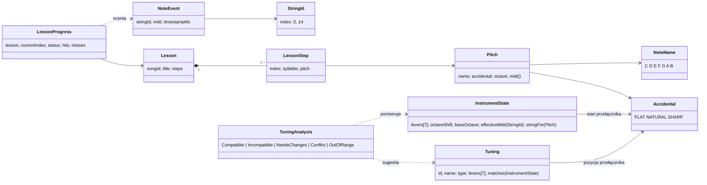

# Model domenowy aplikacji: lekcje, nuty i zdarzenia instrumentu

* **Wersja:** 1.1
* **Data:** 2026-11-13
* **Powiązane dokumenty:** [ADR 009](adr/009-domain-model.md), [ADR 010 – katalog tylko do odczytu](adr/010-catalog-versioning-and-user-state.md), [ADR 008 – architektura warstwowa](adr/008-mobile-app-layered-architecture.md), [Mapowanie strun](note-mapping.md), [Protokół BLE](protocol/ble-protocol.md), [ADR 001](adr/001-system-responsibilities.md)

Dokument definiuje pojęcia domenowe, którymi posługuje się aplikacja mobilna w trybie nauki. Zastępuje on operowanie surowymi napisami (np. `"G#4"`) jednoznacznymi typami. Model jest **niezależny od Androida, Rooma i warstwy BLE**: można go w całości przetestować testami jednostkowymi.

Model należy do warstwy `domain` z [ADR 008](adr/008-mobile-app-layered-architecture.md):

| Warstwa | Odpowiedzialność w trybie nauki |
| :--- | :--- |
| `domain` | Typy z tego dokumentu, walidacja katalogu (§6), ocena kroku (`LessonProgress`), przygotowanie lekcji z utworu i analiza zgodności strojenia (§3.4). |
| `device` | Odwzorowanie ramek protokołu na `NoteEvent` i `InstrumentState` (§7). `InstrumentRepository` udostępnia strumienie tych typów. |
| `data` | Odczyt katalogu (`songs.json`, Room) jako model `Song` z surowymi nutami. Bez interpretowania nut. |
| `presentation` | Przechowywanie bieżącego `LessonProgress`, wyświetlanie kroków i błędów walidacji. |

Notacja dźwięków jest anglosaska (`C D E F G A B`), zgodnie z [note-mapping](note-mapping.md).

---

## 1. Przegląd

Najważniejsza zasada: **`StringId` (gdzie zagrano) i `Pitch` (jaki dźwięk) to różne pojęcia.** Ta sama struna daje różne dźwięki zależnie od przełączników i transpozycji. Do jednego dźwięku może też prowadzić więcej niż jedna konfiguracja.

---

## 2. Typy wartości

### 2.1 `StringId`

Indeks fizycznej struny `0..14` (tabela §2 w note-mapping). Nie niesie informacji o wysokości dźwięku.

- Wartość spoza `0..14` **NIE MOŻE** zostać utworzona. Konstrukcja z niezweryfikowanego źródła (np. z ramki BLE) zwraca „brak wartości” zamiast zgłaszać wyjątek.
- Liczba strun: `15`.

### 2.2 `NoteName`

Nazwa stopnia gamy wraz z odległością od C w półtonach i indeksem przełącznika (note-mapping §3):

| `NoteName` | Półtony od C | Indeks przełącznika (`lever[i]`) |
| :---: | :---: | :---: |
| C | 0 | 0 |
| D | 2 | 1 |
| E | 4 | 2 |
| F | 5 | 3 |
| G | 7 | 4 |
| A | 9 | 5 |
| B | 11 | 6 |

### 2.3 `Accidental`

Znak chromatyczny: `FLAT` (−1, zapis `b`), `NATURAL` (0, brak znaku), `SHARP` (+1, zapis `#`).
Ten sam typ opisuje **stan przełącznika** (`LeverOffset ∈ {−1, 0, +1}` z note-mapping §3).

### 2.4 `Pitch`

Wysokość dźwięku: `NoteName` + `Accidental` + oktawa.

- Numer MIDI: `midi = (octave + 1) × 12 + półtony(NoteName) + offset(Accidental)`.
  Wynik zgadza się z tabelami note-mapping: `C2 = 36`, `C4 = 60`, `B0 = 23`, `C#5 = 73`.
- Zapis tekstowy: `<litera><znak?><oktawa>`, np. `G4`, `G#4`, `Bb3`.
- **Równość** porównuje pisownię: `G4 ≠ G#4 ≠ G5`, a `G#4 ≠ Ab4`.
- **Enharmonia**: `G#4` i `Ab4` mają to samo `midi` (68). Rozpoznaje je osobna operacja „czy enharmoniczne”.
- `Pitch` z numeru MIDI (np. ze zdarzenia harfy) jest zapisywany **z krzyżykami**, zgodnie z nazwami plików w note-mapping §5 (`cs`, `ds`, `fs`, `gs`, `as`).

#### Parsowanie zapisu tekstowego

Parsowanie **nigdy nie zgłasza wyjątku**. Zwraca poprawny `Pitch` albo błąd z powodem:

| Wejście | Wynik |
| :--- | :--- |
| `null`, `""`, `"   "` | błąd `EMPTY` |
| `"G4"`, `" g4 "` | `G4` (białe znaki obcinane, litera bez względu na wielkość) |
| `"G#4"`, `"Gb4"` | `G#4`, `Gb4` |
| `"H4"`, `"G##4"`, `"G"`, `"4G"`, `"G#"`, `"G10"` | błąd `MALFORMED` |

Gramatyka: litera `A–G`, opcjonalnie jeden znak `#` lub `b`, oktawa jedną cyfrą `0..8`.

### 2.5 Zakres instrumentu

Zakres osiągalny na harfie to `B0..C#5`, czyli MIDI `23..73` (note-mapping §5): bazowe `C2..C4`, rozszerzone przełącznikami ±1 i transpozycją ±12. Dźwięk spoza tego zakresu jest **niegrywalny** przy każdym ustawieniu instrumentu.

---

## 3. Stan instrumentu

### 3.1 `InstrumentState`

Aktualne strojenie, którego źródłem prawdy jest harfa (ADR 001). Aplikacja odtwarza je z ramki `CONFIG_STATE` (protokół §4.8).

| Pole | Typ | Znaczenie |
| :--- | :--- | :--- |
| `levers` | 7 × `Accidental` | Stan przełączników dla `C D E F G A B`. |
| `octaveShift` | `−1`, `0`, `+1` | Transpozycja oktawowa. |
| `baseOctave` | liczba | Oktawa najniższej struny (dla obecnej konstrukcji: `2`). |

Stan domyślny, obowiązujący przed pierwszym `CONFIG_STATE`: wszystkie przełączniki `NATURAL`, `octaveShift = 0`, `baseOctave = 2`.

Stan domyślny jest nieodróżnialny od harfy, która naprawdę ma wszystkie przełączniki w pozycji `NATURAL`. Dlatego `InstrumentRepository` udostępnia osobny strumień **`configurationKnown`**: `true` od pierwszej poprawnej ramki `CONFIG_STATE`, `false` po rozłączeniu. Wszystko, co ocenia strojenie (ostrzeżenia z §3.4, wykryta tonacja z §3.3), działa tylko przy aktywnym połączeniu i `configurationKnown = true`.

### 3.2 Operacje

- **`effectiveMidi(StringId)`**: wzór z note-mapping §4:
  `BaseMIDI[id] + offset(levers[Step(id)]) + octaveShift × 12`.
- **`stringFor(Pitch)`**: struna, która przy obecnym strojeniu wyda dany dźwięk (porównanie po `midi`). Zwraca „brak” w dwóch przypadkach: dźwięk jest poza zakresem albo jest w zakresie, ale wymaga innej pozycji przełącznika lub transpozycji. Aplikacja podpowiada wtedy zmianę ustawienia (§3.4). Wynik służy też do wyznaczenia maski LED w `LESSON_STEP`.

Przykłady:

| Stan | Zapytanie | Wynik |
| :--- | :--- | :--- |
| domyślny | `effectiveMidi(5)` | `45` (A2) |
| `lever[A] = SHARP` | `effectiveMidi(5)` | `46` (A#2), jak w protokole §9.3 |
| `octaveShift = +1` | `effectiveMidi(11)` | `67` (G4) |
| domyślny | `stringFor(G4)` | brak (wymaga transpozycji) |
| `octaveShift = +1` | `stringFor(G4)` | `StringId(11)` |

### 3.3 Strojenie na ekranie „Harfa”

Ekran pokazuje `InstrumentRepository.instrumentState` tylko przy aktywnym połączeniu, a bez niego wyświetla stan pusty z przejściem do łączenia. Między połączeniem a pierwszą ramką `CONFIG_STATE` (zwykle krócej niż sekundę) ekran może pokazać stan domyślny z §3.1. To świadome uproszczenie.

Strojenie i stan instrumentu pokazuje osobna, czwarta zakładka „Harfa” w dolnej nawigacji. Ekran Bluetooth służy tylko do wyszukiwania harfy i łączenia z nią, więc stan instrumentu nie trafia do niego. Ikona połączenia na górnym pasku prowadzi do ekranu Bluetooth. Ekran „Harfa” nie ma kontrolek zmiany strojenia, bo jego źródłem prawdy jest harfa (ADR 001).

Po połączeniu ekran ma dwie zakładki:

- **Strojenie** pokazuje 7 przełączników (C–B, ♭/♮/♯) i transpozycję oktawową jako suwak z trzema pozycjami. Pod każdą pozycją jest stały zakres strun dla przełączników naturalnych (np. C2–C4), niezależny od ustawienia przełączników. Kliknięcie nuty zaznacza wszystkie jej struny (`HarpLayout.stringsOf`) na potrzeby przyszłej animacji. Zaznaczenie jest tylko stanem interfejsu w `HarpViewModel` i nie zmienia strojenia.
  - **Wykryta tonacja.** Pod przyciskami przełączników jest linia „Wykryta tonacja: …” z nazwami wszystkich strojeń z katalogu, które pasują do bieżących przełączników (`Tuning.matches`, bez względu na oktawę). Dur i równoległy moll mają te same przełączniki, więc zwykle pasują dwa, np. „C-dur / a-moll” (molle zapisujemy małą literą). Gdy nic nie pasuje albo strojenie nie jest znane (§3.1), linia jest ukryta.
  - **Pomoc w strojeniu dla utworu.** Ekran otwarty z utworu (trasa `harp?songId=…`) pokazuje kartę „Strojenie dla: {tytuł}” z tonacją utworu i wynikiem analizy z §3.4. Przełączniki do zmiany mają czerwoną ramkę i docelową pozycję („→ ♯”), a docelowa oktawa jest wyróżniona na suwaku. Gdy harfa jest nastrojona, karta zmienia się na zieloną i pokazuje przycisk „Wróć do utworu”, który wraca do tego samego wpisu utworu bez utraty stanu lekcji. Ekran otwarty z dolnej nawigacji nie ma karty.
- **Urządzenie** pokazuje nazwę i identyfikator podłączonej harfy oraz sekcję baterii z `InstrumentRepository.batteryStatus`: poziom naładowania, napięcie, źródło zasilania (`BatteryPowerState`) i niski poziom (`isLow`). Gdy `batteryStatus` albo któreś z jego pól ma wartość `null` (harfa bez `CAP_BATTERY`, brak ramki `BATTERY_STATE` albo nieznana wartość), sekcja pokazuje „—”.

### 3.4 Strojenie utworu i analiza zgodności

**`Tuning`** to nazwane ustawienie przełączników z katalogu `assets/tunings.json`: `id`, `name` (np. „G-dur”), `type` (`MAJOR`, `MINOR`, `MODAL`) i pozycje wszystkich 7 przełączników. Strojenie **nie zawiera oktawy**: transpozycja zależy od zakresu nut utworu i dobiera ją analiza. Katalog strojeń jest danymi tylko do odczytu, tak jak katalog utworów ([ADR 010](adr/010-catalog-versioning-and-user-state.md)). Wpis z nieznaną wartością albo bez kompletu przełączników jest pomijany (z ostrzeżeniem w logu).

Każdy utwór wskazuje swoje strojenie polem `Song.tuningId`. Na ekranie utworu jest ono pokazane jako „Tonacja: …” pod nagłówkiem „Tekst/Nuty”. Katalog gwarantuje (test `CatalogAssetTest`), że przy przełącznikach przypisanego strojenia i którejś oktawie `−1..+1` da się zagrać wszystkie nuty utworu.

**`AnalyzeTuningUseCase(utwór lub lista nut, bieżący InstrumentState, sugerowane Tuning?)`** zwraca `TuningAnalysis`:

| Wynik | Warunek |
| :--- | :--- |
| `Compatible` | Każda nuta ma strunę przy bieżącym stanie (`stringFor`, porównanie po MIDI, więc z enharmonią). |
| `OutOfRange(pitches)` | Przy żadnej oktawie `−1..+1` nie da się sięgnąć wszystkich nut. |
| `Conflict(conflicts)` | Żadne ustawienie przełączników nie gra całego utworu, bo ten sam stopień jest potrzebny w dwóch pozycjach (np. `E3 F3 F#3 G3`). Każdy konflikt to stopień i nuty, które się o niego biją. |
| `NeedsChanges(levers, octave, target)` | Przełączniki sugerowanego strojenia przy którejś oktawie grają utwór. `levers` zawiera tylko przełączniki strun używanych przez utwór, które trzeba przestawić; `octave` jest pusta, gdy oktawa się zgadza. `target` to docelowy stan. |
| `Incompatible` | Utworu nie da się zagrać, ale brak grywalnej sugestii. Ostrzeżenie bez listy zmian. |

Oktawy są sprawdzane w kolejności: bieżąca, `0`, pozostałe. Analiza nie szuka „najmniejszej zmiany” — celem jest zawsze strojenie przypisane do utworu.

Ostrzeżenia na ekranie utworu (tylko przy znanym strojeniu, §3.1):

- **Baner** pod przyciskami nauki, gdy wynik nie jest `Compatible`. Mówi o zmianie tonacji i oktawy („Zmień tonację na: G-dur”, „Zmień oktawę na: +1”), a nie o pojedynczych przełącznikach. Przycisk „Pomoc w strojeniu” otwiera ekran „Harfa” z kartą utworu (§3.3). Baner znika sam po przestrojeniu harfy.
- **Dialog przy ręcznym starcie nauki**: „Otwórz pomoc w strojeniu”, „Zacznij mimo to” albo „Anuluj”. Lekcja wznowiona z zapisanego postępu nie pokazuje dialogu, tylko baner.
- **Podpowiedź dla bieżącego kroku**, gdy jego nuta nie ma struny (`LESSON_STEP` z pustą maską, §5.3). Zastępuje baner i mówi, której nuty dotyczy.

---

## 4. Zdarzenia instrumentu

### 4.1 `NoteEvent`

Domenowa postać zagrania struny, tworzona z ramki `STRING_EVENT` (protokół §4.7).

| Pole | Znaczenie |
| :--- | :--- |
| `stringId` | `StringId` zagranej struny. |
| `midi` | Efektywny numer MIDI podany przez harfę. **Wartość autorytatywna**: aplikacja jej nie przelicza ani nie nadpisuje. |
| `timestampMs` | Znacznik czasu harfy (mod 65 536), wyłącznie do liczenia odstępów. |
| `pitch` *(pochodne)* | `Pitch` z `midi`, zapisany z krzyżykami. Służy do prezentacji. |

Ramka, z której nie da się utworzyć poprawnego `NoteEvent` (np. `string_id > 14`), jest odrzucana i logowana zgodnie z protokołem §6.2. Nie powoduje awarii.

### 4.2 Źródła zdarzeń

Tryb nauki reaguje **wyłącznie** na `NoteEvent`. Stary format mocka (pojedyncza litera, np. `"F\n"` przez SPP) nie niesie oktawy ani numeru struny, więc nie jest przekładany na `NoteEvent`.

Źródłem `NoteEvent` jest klient BLE GATT (ADR 007). `HarpSession` dekoduje notyfikacje TX harfy i kontroluje numery sekwencyjne, a następnie `InstrumentEventStream` zamienia `STRING_EVENT` i `CONFIG_STATE` na `NoteEvent` i `InstrumentState`. Oba trafiają do `InstrumentRepository` jako osobne strumienie (`noteEvents`, `instrumentState`) oraz do wspólnego strumienia `events`. Mock harfy musi wysyłać ramki protokołu przez BLE, bo stary mock SPP nie jest obsługiwany.

`InstrumentEventStream` zamienia też `BATTERY_STATE` na `BatteryStatus`. `InstrumentRepository.batteryStatus` udostępnia go tylko przy aktywnym połączeniu z harfą deklarującą `CAP_BATTERY`, a w pozostałych przypadkach ma wartość `null`.

---

## 5. Lekcja

### 5.1 `Lesson` i `LessonStep`

- `Lesson` to zweryfikowana lekcja utworzona z utworu z katalogu: `songId`, `title` i **niepusta** lista kroków.
- `LessonStep` to jeden krok: `index` (pozycja w lekcji), `syllable` (tekst do wyświetlenia) i oczekiwany `pitch`.
- Krok jest trafiony, gdy `NoteEvent.midi == step.pitch.midi`. Porównanie po MIDI oznacza, że enharmoniczny zapis w katalogu (`Ab4` lub `G#4`) daje ten sam wynik. Natomiast `G4`, `G#4` i `G5` są różnymi krokami.

`Lesson` może powstać **tylko** w wyniku walidacji katalogu (§6). Nie da się utworzyć lekcji z niepoprawnymi danymi.

### 5.2 `LessonProgress`

Niemutowalny stan przebiegu lekcji, którego właścicielem jest aplikacja (ADR 001).

| Pole | Znaczenie |
| :--- | :--- |
| `lesson` | Lekcja, której dotyczy postęp. |
| `currentIndex` | Indeks oczekiwanego kroku. |
| `status` | `IN_PROGRESS`, `PAUSED` albo `COMPLETED`. |
| `hits`, `misses` | Liczba trafień i pomyłek. |

Każde zdarzenie daje nowy stan oraz wynik kroku, który odpowiada `LESSON_RESULT` z protokołu §4.10:

| Status | Zdarzenie | Wynik | Nowy stan |
| :--- | :--- | :--- | :--- |
| `IN_PROGRESS` | zgodne `midi`, nie ostatni krok | `HIT` | `currentIndex + 1`, `hits + 1` |
| `IN_PROGRESS` | zgodne `midi`, ostatni krok | `COMPLETE` | `COMPLETED`, `hits + 1` |
| `IN_PROGRESS` | niezgodne `midi` | `MISS` | ten sam krok, `misses + 1` |
| `PAUSED` / `COMPLETED` | dowolne | `IGNORED` | bez zmian |

`PAUSED` realizuje zachowanie po utracie BLE z ADR 001: zachowany jest ostatni potwierdzony krok, a wznowienie wraca do `IN_PROGRESS` od tego samego `currentIndex`.

Do `PAUSED` prowadzą trzy sytuacje:

| Przyczyna | Wznowienie |
| :--- | :--- |
| Utrata połączenia z harfą | Automatycznie po ponownym połączeniu. Użytkownik nie może wznowić lekcji ręcznie. |
| Pauza użytkownika | Tylko przez użytkownika. Ponowne połączenie nie wznawia lekcji. |
| Start lekcji bez połączonej harfy | Automatycznie po połączeniu, od pierwszego kroku. |

Gdy użytkownik wznowi lekcję bez połączenia, pozostaje ona wstrzymana jak po utracie BLE i rusza sama po połączeniu. Powtórzenie lekcji („Zagraj ponownie”) tworzy nowy `LessonProgress` od kroku 0.

### 5.3 Sterowanie lekcją na harfie

Przebieg lekcji na komendy protokołu przekłada `InstrumentLessonController` (warstwa `domain`). Komendy wysyła tylko przy aktywnym połączeniu, a komendy z poprzedniej sesji nie są ponawiane (spec §8 pkt 9).

| Zdarzenie w aplikacji | Komendy |
| :--- | :--- |
| Start lub powtórzenie lekcji | `LESSON_START`, `LESSON_STEP` dla kroku 0 |
| `HIT` | `LESSON_RESULT(HIT)`, `LESSON_STEP` dla kolejnego kroku |
| `MISS` | `LESSON_RESULT(MISS)` |
| `COMPLETE` | `LESSON_RESULT(COMPLETE)` |
| Pauza użytkownika | `LESSON_END`, bo protokół nie ma komendy pauzy |
| Wznowienie (ręczne albo po ponownym połączeniu) | `LESSON_START`, `LESSON_STEP` dla bieżącego kroku |
| Zmiana `InstrumentState` w trakcie kroku | ponowny `LESSON_STEP` z tym samym indeksem, gdy zmieniła się maska |
| Zakończenie nauki | `LESSON_END` |

Ponowny `LESSON_STEP` po zmianie strojenia obsługuje zarówno przestawienie przełącznika, jak i `CONFIG_STATE`, które po handshake dociera już po wznowieniu lekcji. Krok, którego nuta nie ma struny, jest wysyłany z pustą maską; aplikacja pokazuje wtedy podpowiedź z §3.4, a po przestrojeniu wysyła krok ponownie z właściwą maską. Komenda jest idempotentna (spec §4.9). Po `COMPLETE`, `LESSON_END` i utracie połączenia harfa nie ma aktywnego kroku, więc zmiana strojenia niczego nie wysyła.

Zestaw komend zależy od możliwości z `DEVICE_INFO` (`InstrumentCapabilities`):

| Możliwości | Zachowanie |
| :--- | :--- |
| `CAP_LESSON` | Komendy `LESSON_*` jak w tabeli powyżej. |
| tylko `CAP_LEDS` | `LESSON_STEP` → `LED_SET(mask, świecenie ciągłe)`, `COMPLETE` i `LESSON_END` → `LED_SET(0)`. `LESSON_START` oraz `HIT`/`MISS` są pomijane. |
| brak obu | Nic nie jest wysyłane. Lekcja działa wyłącznie na ekranie aplikacji. |

---

## 6. Walidacja katalogu

Utwory w katalogu (`songs.json`, baza Room) zawierają surowe pary `syllable` i `note`. Są to dane wejściowe, a nie model domenowy. Katalog nie przechowuje danych wyliczanych z nuty, takich jak numer struny, stopień czy MIDI ([ADR 009](adr/009-domain-model.md)).

Walidator przyjmuje identyfikator i tytuł utworu oraz listę surowych kroków (`syllable`, `note`). Pola mogą być puste lub `null`, bo pochodzą z deserializacji. Walidator nie zależy od encji Room. Warstwa `data` mapuje encję na model `Song`. Przypadek użycia w `domain` przekształca `Song.lyricsWithNotes` na surowe kroki i uruchamia walidację.

**Przed rozpoczęciem lekcji** utwór przechodzi walidację, której wynikiem jest:

- `Valid(lesson)`, gdy wszystkie kroki są poprawne,
- `Invalid(issues)`, czyli lista **wszystkich** znalezionych problemów (nie tylko pierwszego).

| Kod problemu | Warunek |
| :--- | :--- |
| `NO_STEPS` | Utwór nie ma żadnej nuty. |
| `EMPTY` | Pusta nuta w kroku `i`. |
| `MALFORMED` | Niepoprawny zapis nuty w kroku `i` (§2.4). |
| `OUT_OF_RANGE` | Nuta w kroku `i` poza zakresem `B0..C#5` (§2.5). |

Każdy problem zawiera indeks kroku i oryginalny zapis, aby UI mógł pokazać np. „krok 12: D5 poza zakresem harfy”.

Zachowanie aplikacji:

- Walidacja **nigdy nie zgłasza wyjątku**. Niepoprawna lub pusta nuta nie powoduje awarii.
- Utwór `Invalid` **pozostaje w katalogu** i można go odsłuchać (MIDI), ale **tryb nauki się nie uruchamia**. UI pokazuje listę problemów.
- Dane katalogu nie są automatycznie poprawiane ani transponowane.
- Walidacja nie sprawdza bieżącego `InstrumentState`. Nuta w zakresie, ale wymagająca innego ustawienia przełączników, jest poprawna. Obsługuje ją `stringFor` (§3.2) w trakcie lekcji.

Stan obecnego katalogu: wszystkie utwory są `Valid`. *Hallelujah* zostało przeniesione do tonacji pliku MIDI (C-dur) i obniżone o oktawę (`C3..E4`), a nuty niezgodne z MIDI poprawiono.

---

## 7. Odwzorowanie na protokół BLE

| Protokół (ramka) | Model domenowy |
| :--- | :--- |
| `STRING_EVENT.string_id` | `NoteEvent.stringId` (`StringId`) |
| `STRING_EVENT.midi` | `NoteEvent.midi` |
| `STRING_EVENT.t_ms` | `NoteEvent.timestampMs` |
| `CONFIG_STATE.octave_shift − 1` | `InstrumentState.octaveShift` |
| `CONFIG_STATE.lever[i] − 1` | `InstrumentState.levers[NoteName o indeksie i]` (`Accidental`) |
| `CONFIG_STATE.base_octave` | `InstrumentState.baseOctave` |
| pierwsza poprawna ramka `CONFIG_STATE` | `configurationKnown = true` (do rozłączenia) |
| `BATTERY_STATE.percent` | `BatteryStatus.percent` (`0xFF` → `null`) |
| `BATTERY_STATE.millivolts` | `BatteryStatus.millivolts` (`0` → `null`) |
| `BATTERY_STATE.flags` bity 0–1 | `BatteryStatus.powerState` (priorytet: `CHARGING`, `EXTERNAL_POWER`, `DISCHARGING`) |
| `BATTERY_STATE.flags` bit 2 | `BatteryStatus.isLow` |
| `LESSON_START.total_steps` | `Lesson.steps.size` |
| `LESSON_STEP.index` | `LessonProgress.currentIndex` |
| `LESSON_STEP.mask` | bit `stringFor(currentStep.pitch)` (pusta maska, gdy brak struny), wyliczany ponownie po każdej zmianie `InstrumentState` |
| `DEVICE_INFO.caps` | `InstrumentCapabilities` (`leds`, `battery`, `lesson`; nieznane bity są pomijane) |
| `LESSON_RESULT.result` | wynik kroku: `MISS`, `HIT`, `COMPLETE` (`IGNORED` nie jest wysyłany) |

Odwzorowanie ramki na model zwraca „brak wartości” zamiast zgłaszać wyjątek, gdy pola są niepoprawne. Należy ono do warstwy urządzenia (klient BLE i kodek), a nie do modelu domenowego.

---

## 8. Kryteria akceptacji (testy)

Model **MUSI** przechodzić testy jednostkowe, które obejmują co najmniej:

1. `G4`, `G#4` i `G5` są różnymi wartościami `Pitch` o różnych `midi` (67, 68, 79).
2. Parsowanie `null`, `""` i `"   "` daje `EMPTY`. Parsowanie `"H4"`, `"G##4"`, `"G"` i `"4G"` daje `MALFORMED`. Żadne z nich nie zgłasza wyjątku.
3. `Pitch` z MIDI i z powrotem zachowuje `midi` dla całego zakresu `23..73`. `Ab4` i `G#4` są enharmoniczne, ale nie są równe.
4. `effectiveMidi` i `stringFor` dają wyniki z tabeli w §3.2.
5. Walidacja utworu z pustą nutą, śmieciowym zapisem i `E5` daje `Invalid` z trzema problemami o właściwych indeksach. Utwór bez nut daje `NO_STEPS`.
6. Postęp lekcji: `HIT` przesuwa krok, `MISS` nie przesuwa. Ostatni `HIT` daje `COMPLETE`, a potem wszystkie zdarzenia są `IGNORED`. Zagranie `G#4` przy oczekiwanym `G4` to `MISS`. W stanie `PAUSED` zdarzenia są `IGNORED`.
7. Walidacja całego `songs.json` kończy się bez wyjątku i wszystkie utwory są `Valid`. Każdy utwór ma `tuningId` istniejące w `tunings.json`, przy którym da się go zagrać; każdy wpis `tunings.json` jest poprawny i ma unikalne `id`.
8. Ramki `STRING_EVENT` i `CONFIG_STATE` z [`test-vectors.json`](protocol/test-vectors.json) poprawnie przekładają się na `NoteEvent` i `InstrumentState`.
9. Sterowanie lekcją z `FakeInstrumentRepository` (`InstrumentLessonControllerTest`, `SongViewModelTest`) wysyła komendy z tabel w §5.3. Obejmuje to: pełną lekcję, pauzę i wznowienie, powtórzenie, utratę i odzyskanie połączenia, start bez połączenia, zmianę strojenia w trakcie kroku oraz harfę bez `CAP_LESSON`.
10. Analiza strojenia (`AnalyzeTuningUseCase`) rozróżnia wszystkie wyniki z §3.4. Testy obejmują: strojenie naturalne, jeden przełącznik, oktawę, konflikt, nuty poza zakresem, enharmonię (`G#4` jako `Ab`), pierwszeństwo sugestii i brak grywalnej sugestii.
11. `configurationKnown` jest `false` przed pierwszym `CONFIG_STATE` i po rozłączeniu. Bez połączenia i przed pierwszą ramką nie ma ostrzeżenia o strojeniu.
12. Ostrzeżenia na ekranie utworu (`SongViewModelTest`): baner znika po przestrojeniu, dialog przy ręcznym starcie, brak dialogu przy wznowieniu, podpowiedź przy pustej masce i ponowny `LESSON_STEP` z właściwą maską po przestrojeniu.
13. Ekran „Harfa” (`HarpViewModelTest`): wykryta tonacja pokazuje wszystkie pasujące strojenia albo nic; karta utworu pojawia się tylko po wejściu z utworu i staje się `Compatible` po przestrojeniu.
