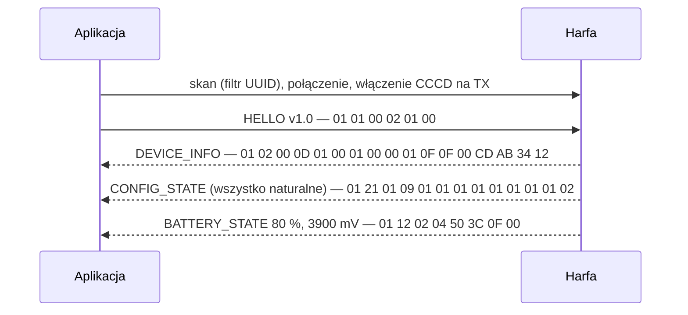
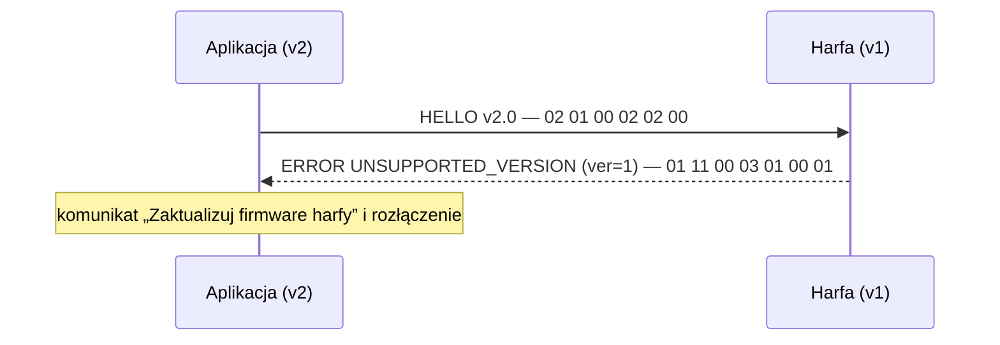
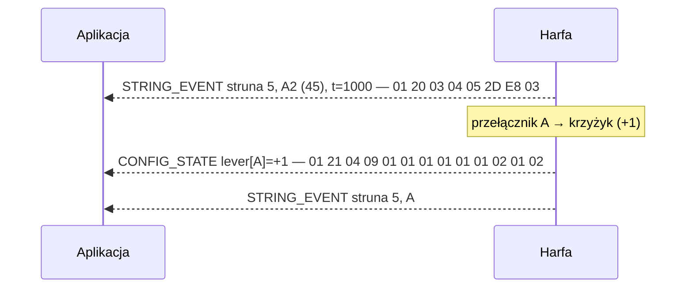
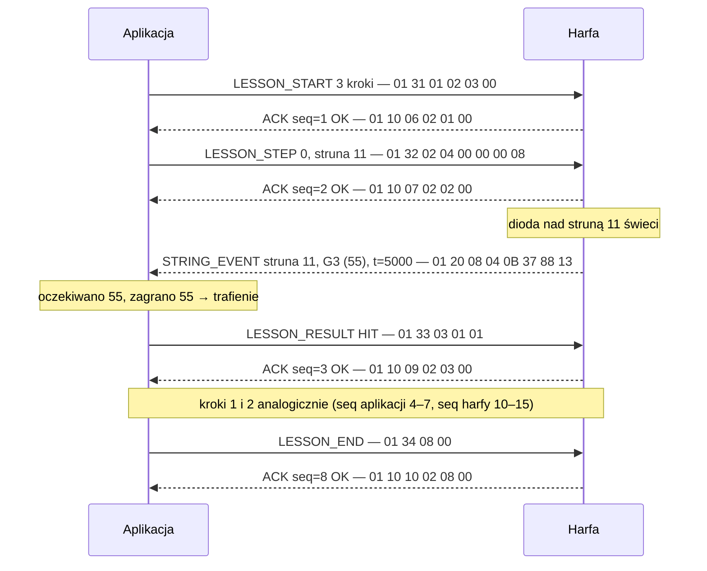
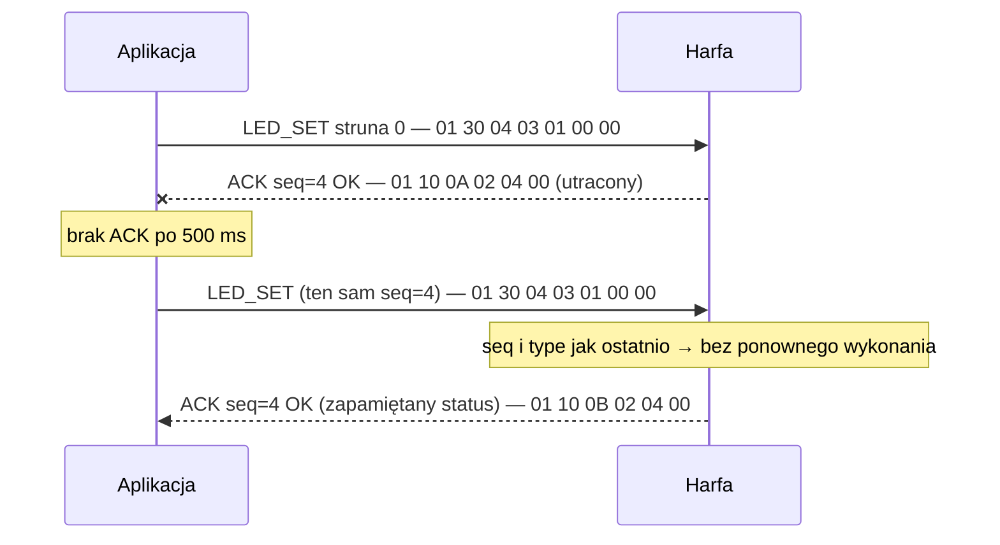
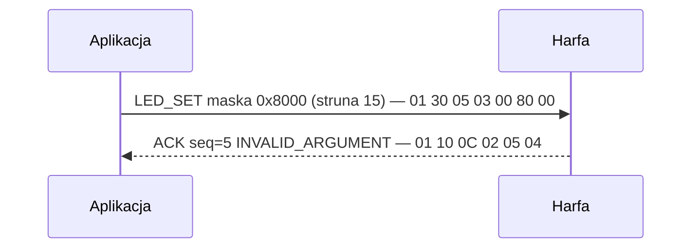
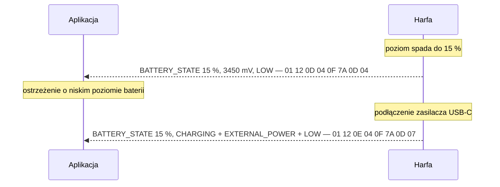

# Protokół komunikacji BLE: Harfa ↔ Aplikacja mobilna

* **Wersja protokołu:** 1.0
* **Data:** 2026-11-03
* **Powiązane dokumenty:** [ADR 007](../adr/007-ble-protocol.md), [Mapowanie strun](../note-mapping.md), [Specyfikacja techniczna](../specification.md)

Dokument definiuje kontrakt komunikacyjny pomiędzy harfą (firmware STM32WB55) a aplikacją mobilną. Opis jest **niezależny od implementacji**: nie zakłada języka programowania, biblioteki BLE ani konkretnego mikrokontrolera. Obie strony implementują protokół wyłącznie na podstawie tego dokumentu oraz pliku wektorów testowych (sekcja 10).

Słowa **MUSI**, **NIE MOŻE**, **POWINIEN** i **MOŻE** oznaczają odpowiednio wymaganie bezwzględne, zakaz, zalecenie oraz opcję.

Terminologia:
- **Harfa** – instrument (peryferium BLE, serwer GATT).
- **Aplikacja** – aplikacja mobilna (central BLE, klient GATT).
- **Ramka** – pojedyncza wiadomość protokołu.
- **Komenda** – ramka wysyłana przez aplikację do harfy.
- **Zdarzenie** – ramka wysyłana przez harfę do aplikacji.

---

## 1. Warstwa BLE (GATT)

### 1.1 Usługa i charakterystyki

Harfa udostępnia jedną dedykowaną usługę GATT z dwiema charakterystykami:

| Element | UUID | Właściwości | Kierunek |
| :--- | :--- | :--- | :--- |
| Usługa **HARFA** | `3CFB0001-6F66-44DE-A34A-0BCE651D326C` | – | – |
| Charakterystyka **RX** | `3CFB0002-6F66-44DE-A34A-0BCE651D326C` | Write, Write Without Response | Aplikacja → Harfa |
| Charakterystyka **TX** | `3CFB0003-6F66-44DE-A34A-0BCE651D326C` | Notify | Harfa → Aplikacja |

- Każdy zapis do RX oraz każda notyfikacja z TX zawiera **dokładnie jedną ramkę**. Ramki nie są dzielone ani łączone.
- Aplikacja **MUSI** włączyć notyfikacje (zapis do deskryptora CCCD charakterystyki TX) przed wysłaniem pierwszej komendy.
- Aplikacja **POWINNA** używać `Write Without Response` – potwierdzenie wykonania zapewnia warstwa protokołu (sekcja 5).
- Bateria, wersja firmware i możliwości instrumentu są przesyłane wiadomościami protokołu. Harfa nie udostępnia standardowych usług Battery Service ani Device Information Service.

### 1.2 Identyfikacja urządzenia (advertising)

Aplikacja **NIE MOŻE** identyfikować harfy po adresie MAC.

- Harfa **MUSI** umieszczać 128-bitowy UUID usługi HARFA w pakiecie reklamowym (*Complete List of 128-bit Service UUIDs*).
- Harfa **MUSI** umieszczać nazwę urządzenia w odpowiedzi na skanowanie (*Scan Response*) w formacie `HARFA-XXXX`, gdzie `XXXX` to młodsze 16 bitów `device_id` zapisane czterema wielkimi cyframi szesnastkowymi (np. `device_id = 0x1234ABCD` → `HARFA-ABCD`).
- Aplikacja **MUSI** wyszukiwać urządzenia filtrem po UUID usługi. Nazwa służy wyłącznie do prezentacji użytkownikowi.
- Po udanym handshake aplikacja **POWINNA** zapamiętać `device_id` (z `DEVICE_INFO`, sekcja 4.2) jako trwały identyfikator instrumentu. Ostatni adres BLE **MOŻE** być przechowywany wyłącznie jako wskazówka przyspieszająca ponowne połączenie.

### 1.3 Parametry połączenia

- Protokół w wersji 1 **MUSI** działać przy domyślnym `ATT_MTU = 23`, czyli maksymalnie **20 bajtów** na ramkę. Aplikacja **MOŻE** negocjować większe MTU, ale nie zmienia to limitów protokołu v1.
- Aplikacja **POWINNA** żądać wysokiego priorytetu połączenia (interwał 7,5–15 ms), aby opóźnienie zdarzenia struny nie przekraczało ~50 ms.

### 1.4 Bezpieczeństwo

Wersja 1.0 nie wymaga parowania ani bondingu. Połączenie jest nieszyfrowane. Wprowadzenie bondingu (np. *Just Works*) wymaga nowej wersji protokołu (sekcja 7).

---

## 2. Format ramki

### 2.1 Struktura

```
 bajt:   0        1        2        3        4 ... 4+len-1
       +--------+--------+--------+--------+-----------------+
       |  ver   |  type  |  seq   |  len   |  payload[len]   |
       +--------+--------+--------+--------+-----------------+
```

| Pole | Typ | Opis |
| :--- | :--- | :--- |
| `ver` | u8 | Wersja **główna** (major) protokołu. Dla wersji 1.x: `0x01`. |
| `type` | u8 | Typ wiadomości (sekcja 3). |
| `seq` | u8 | Numer sekwencyjny nadawcy (sekcja 5.1). |
| `len` | u8 | Długość payloadu w bajtach, `0..16`. |
| `payload` | `len` bajtów | Treść zależna od `type`. |

### 2.2 Zasady kodowania

- Wartości wielobajtowe są zapisywane w porządku **little-endian**.
- Pola są **bez znaku** (`u8`, `u16`, `u32`), chyba że opis stanowi inaczej.
- Maksymalna długość ramki: 4 bajty nagłówka + 16 bajtów payloadu = **20 bajtów**.
- Długość ramki **MUSI** wynosić dokładnie `4 + len`. Ramka o innej długości jest niepoprawna (`MALFORMED`).
- Pola zarezerwowane i niezdefiniowane bity **MUSZĄ** być wysyłane jako `0` i **MUSZĄ** być ignorowane przy odbiorze.
- Na diagramach ramki zapisywane są jako ciąg bajtów szesnastkowych, np. `01 20 03 04 05 2D E8 03`.

---

## 3. Katalog wiadomości

### 3.1 Zakresy typów

| Zakres | Kategoria | Kierunek |
| :--- | :--- | :--- |
| `0x00–0x0F` | Sesja i handshake | oba |
| `0x10–0x1F` | System: potwierdzenia, błędy, bateria | Harfa → Aplikacja |
| `0x20–0x2F` | Zdarzenia instrumentu | Harfa → Aplikacja |
| `0x30–0x3F` | Komendy LED i lekcji | Aplikacja → Harfa |
| `0x40–0xFF` | Zarezerwowane na przyszłe wersje | – |

### 3.2 Zestawienie (wersja 1.0)

| `type` | Nazwa | Kierunek | `len` (min.) | Odpowiedź |
| :---: | :--- | :--- | :---: | :--- |
| `0x01` | `HELLO` | A → H | 2 | `DEVICE_INFO` albo `ERROR` |
| `0x02` | `DEVICE_INFO` | H → A | 13 | – |
| `0x03` | `STATE_REQUEST` | A → H | 1 | `ACK`, następnie ramki stanu |
| `0x10` | `ACK` | H → A | 2 | – |
| `0x11` | `ERROR` | H → A | 3 | – |
| `0x12` | `BATTERY_STATE` | H → A | 4 | – |
| `0x20` | `STRING_EVENT` | H → A | 4 | – |
| `0x21` | `CONFIG_STATE` | H → A | 9 | – |
| `0x30` | `LED_SET` | A → H | 3 | `ACK` |
| `0x31` | `LESSON_START` | A → H | 2 | `ACK` |
| `0x32` | `LESSON_STEP` | A → H | 4 | `ACK` |
| `0x33` | `LESSON_RESULT` | A → H | 1 | `ACK` |
| `0x34` | `LESSON_END` | A → H | 0 | `ACK` |

---

## 4. Definicje wiadomości

### 4.1 `HELLO` (`0x01`, Aplikacja → Harfa)

Rozpoczyna sesję. Aplikacja wysyła ją jako pierwszą ramkę po włączeniu notyfikacji.

| Offset | Pole | Typ | Opis |
| :---: | :--- | :--- | :--- |
| 0 | `proto_major` | u8 | Wersja główna protokołu aplikacji (równa `ver` z nagłówka). |
| 1 | `proto_minor` | u8 | Najwyższa wersja podrzędna obsługiwana przez aplikację. |

Format nagłówka oraz dwóch pierwszych bajtów payloadu `HELLO` jest **zamrożony we wszystkich wersjach protokołu**, aby harfa w dowolnej wersji mogła rozpoznać niezgodność.

Przykład (protokół 1.0, `seq = 0`): `01 01 00 02 01 00`

### 4.2 `DEVICE_INFO` (`0x02`, Harfa → Aplikacja)

Odpowiedź na poprawny `HELLO`. Identyfikuje firmware oraz możliwości instrumentu.

| Offset | Pole | Typ | Opis |
| :---: | :--- | :--- | :--- |
| 0 | `proto_major` | u8 | Wersja główna protokołu harfy. |
| 1 | `proto_minor` | u8 | **Wynegocjowana** wersja podrzędna = `min(minor aplikacji, minor harfy)`. |
| 2 | `fw_major` | u8 | Wersja firmware (semver). |
| 3 | `fw_minor` | u8 | |
| 4 | `fw_patch` | u8 | |
| 5 | `hw_rev` | u8 | Rewizja sprzętu (płytki). |
| 6 | `string_count` | u8 | Liczba strun (dla obecnej konstrukcji: `15`). |
| 7 | `caps` | u16 | Maska możliwości (tabela poniżej). |
| 9 | `device_id` | u32 | Unikalny identyfikator instrumentu (np. wyprowadzony z UID mikrokontrolera). |

Maska `caps`:

| Bit | Nazwa | Znaczenie |
| :---: | :--- | :--- |
| 0 | `CAP_LEDS` | Harfa posiada diody LED nad strunami (`LED_SET`, `LESSON_STEP`). |
| 1 | `CAP_BATTERY` | Harfa raportuje stan baterii (`BATTERY_STATE`). |
| 2 | `CAP_LESSON` | Harfa obsługuje komendy `LESSON_*`. |
| 3 | `CAP_DISPLAY` | Harfa posiada wyświetlacz. |
| 4–15 | – | Zarezerwowane (`0`). |

Aplikacja **NIE MOŻE** używać funkcji, której bit w `caps` nie jest ustawiony. Komenda dotycząca nieobsługiwanej funkcji otrzymuje `ACK` ze statusem `UNKNOWN_TYPE`.

Przykład (firmware 1.0.0, hw 1, 15 strun, wszystkie możliwości, `device_id = 0x1234ABCD`):
`01 02 00 0D 01 00 01 00 00 01 0F 0F 00 CD AB 34 12`

### 4.3 `STATE_REQUEST` (`0x03`, Aplikacja → Harfa)

Prośba o ponowne przesłanie aktualnego stanu, np. po wykryciu luki w numerach sekwencyjnych.

| Offset | Pole | Typ | Opis |
| :---: | :--- | :--- | :--- |
| 0 | `what` | u8 | bit 0: `CONFIG_STATE`, bit 1: `BATTERY_STATE`. Pozostałe bity zarezerwowane. |

Harfa **MUSI** najpierw wysłać `ACK`, a następnie żądane ramki stanu w kolejności rosnących bitów.

Przykład (oba stany, `seq = 5`): `01 03 05 01 03`

### 4.4 `ACK` (`0x10`, Harfa → Aplikacja)

Potwierdzenie przetworzenia komendy.

| Offset | Pole | Typ | Opis |
| :---: | :--- | :--- | :--- |
| 0 | `ack_seq` | u8 | `seq` potwierdzanej komendy. |
| 1 | `status` | u8 | Kod wyniku (sekcja 6). `0x00` = wykonano. |

Przykład (potwierdzenie komendy `seq = 1`, OK, `seq` harfy = 6): `01 10 06 02 01 00`

### 4.5 `ERROR` (`0x11`, Harfa → Aplikacja)

Zgłoszenie błędu, którego nie da się przekazać przez `ACK` (sekcja 6.2).

| Offset | Pole | Typ | Opis |
| :---: | :--- | :--- | :--- |
| 0 | `code` | u8 | Kod błędu (sekcja 6). |
| 1 | `ref_seq` | u8 | `seq` ramki, której dotyczy błąd, lub `0xFF` gdy nieznany / błąd spontaniczny. |
| 2 | `ref_type` | u8 | `type` ramki, której dotyczy błąd, lub `0xFF`. |

Format `ERROR` jest, podobnie jak `HELLO`, **zamrożony we wszystkich wersjach protokołu**.

Przykład (odrzucony `HELLO` w nieobsługiwanej wersji): `01 11 00 03 01 00 01`

### 4.6 `BATTERY_STATE` (`0x12`, Harfa → Aplikacja)

Wymaga `CAP_BATTERY`.

| Offset | Pole | Typ | Opis |
| :---: | :--- | :--- | :--- |
| 0 | `percent` | u8 | Poziom naładowania `0..100`, `0xFF` = nieznany. |
| 1 | `millivolts` | u16 | Napięcie ogniwa w mV, `0` = nieznane. |
| 3 | `flags` | u8 | bit 0: `CHARGING`, bit 1: `EXTERNAL_POWER`, bit 2: `LOW` (≤ 15 %). |

Harfa wysyła `BATTERY_STATE`:
- po handshake,
- natychmiast przy zmianie dowolnej flagi,
- przy zmianie `percent`, nie częściej niż raz na 30 s.

Przykład (80 %, 3900 mV, brak flag, `seq = 2`): `01 12 02 04 50 3C 0F 00`

### 4.7 `STRING_EVENT` (`0x20`, Harfa → Aplikacja)

Zdarzenie przerwania wiązki struny (zagrania struny). Zwolnienie wiązki nie jest raportowane.

| Offset | Pole | Typ | Opis |
| :---: | :--- | :--- | :--- |
| 0 | `string_id` | u8 | Indeks struny `0..14` (zgodnie z [mapowaniem strun](../note-mapping.md)). |
| 1 | `midi` | u8 | **Efektywny** numer MIDI w chwili zdarzenia (wzór z note-mapping §4). |
| 2 | `t_ms` | u16 | Znacznik czasu harfy w ms modulo 65 536. |

- `midi` jest wartością autorytatywną – harfa odtwarza dokładnie ten dźwięk. Aplikacja **MOŻE** weryfikować go na podstawie `CONFIG_STATE`, ale **NIE MOŻE** go nadpisywać.
- `t_ms` służy do wyznaczania odstępów pomiędzy kolejnymi zdarzeniami: `Δ = (t2 − t1) mod 65536`. Nie jest to czas bezwzględny.
- Firmware odpowiada za eliminację drgań (debouncing): jedno przerwanie wiązki = jedno zdarzenie `STRING_EVENT`.

Przykład (struna 5, A2 = MIDI 45, `t_ms = 1000`, `seq = 3`): `01 20 03 04 05 2D E8 03`

### 4.8 `CONFIG_STATE` (`0x21`, Harfa → Aplikacja)

Aktualne strojenie instrumentu: stan przełączników i transpozycja oktawowa. Payload jest **jedyną obowiązującą definicją** ramki konfiguracyjnej opisanej w [note-mapping §6](../note-mapping.md).

| Offset | Pole | Typ | Opis |
| :---: | :--- | :--- | :--- |
| 0 | `octave_shift` | u8 | `OctaveShift + 1` → `0..2` (−1, 0, +1). |
| 1..7 | `lever[0..6]` | 7 × u8 | `LeverOffset + 1` → `0..2` dla stopni C, D, E, F, G, A, B. |
| 8 | `base_octave` | u8 | Oktawa najniższej struny (dla C2: `2`). |

Harfa wysyła `CONFIG_STATE`:
- po handshake,
- **natychmiast po każdej zmianie** przełącznika lub transpozycji, zawsze **przed** kolejnym `STRING_EVENT`, którego `midi` uwzględnia tę zmianę.

Przykład (wszystko w pozycji naturalnej, `seq = 1`): `01 21 01 09 01 01 01 01 01 01 01 01 02`

### 4.9 `LED_SET` (`0x30`, Aplikacja → Harfa)

Ustawia **absolutny** stan diod LED nad strunami. Wymaga `CAP_LEDS`.

| Offset | Pole | Typ | Opis |
| :---: | :--- | :--- | :--- |
| 0 | `mask` | u16 | Bit `i` = dioda nad struną `i`. Diody spoza maski są gaszone. |
| 2 | `mode` | u8 | `0x00` = świecenie ciągłe, `0x01` = miganie. |

- `mask = 0x0000` gasi wszystkie diody.
- Ustawienie bitu `≥ string_count` lub nieznany `mode` → `ACK` ze statusem `INVALID_ARGUMENT`.
- Komenda jest idempotentna. Ostatnia otrzymana komenda `LED_SET` lub `LESSON_STEP` decyduje o stanie diod.

Przykład (dioda nad struną 0, ciągła, `seq = 4`): `01 30 04 03 01 00 00`

### 4.10 Komendy lekcji

Lekcją steruje **aplikacja**: to ona zna utwór, wybiera kolejne nuty i ocenia poprawność na podstawie `STRING_EVENT`. Harfa jedynie podświetla struny i daje lokalny feedback. Wszystkie komendy lekcji wymagają `CAP_LESSON`.

#### `LESSON_START` (`0x31`)

| Offset | Pole | Typ | Opis |
| :---: | :--- | :--- | :--- |
| 0 | `total_steps` | u16 | Liczba kroków lekcji (informacyjnie, np. dla wyświetlacza). |

Rozpoczęcie nowej lekcji w trakcie trwającej zastępuje ją. Przykład (3 kroki, `seq = 1`): `01 31 01 02 03 00`

#### `LESSON_STEP` (`0x32`)

| Offset | Pole | Typ | Opis |
| :---: | :--- | :--- | :--- |
| 0 | `index` | u16 | Numer kroku, `0..total_steps−1`. |
| 2 | `mask` | u16 | Struny do zagrania w tym kroku (podświetlane ciągle). |

Bez aktywnej lekcji → `NOT_READY`. `index ≥ total_steps` lub niepoprawna maska → `INVALID_ARGUMENT`.

Przykład (krok 0, struna 11, `seq = 2`): `01 32 02 04 00 00 00 08`

#### `LESSON_RESULT` (`0x33`)

| Offset | Pole | Typ | Opis |
| :---: | :--- | :--- | :--- |
| 0 | `result` | u8 | `0x00` = `MISS`, `0x01` = `HIT`, `0x02` = `COMPLETE`. |

Harfa **POWINNA** dać wizualny feedback (sposób zależy od implementacji, np. krótkie mignięcie). Po `COMPLETE` harfa gasi diody, ale lekcja trwa do `LESSON_END`. Przykład (`HIT`, `seq = 3`): `01 33 03 01 01`

#### `LESSON_END` (`0x34`)

Brak payloadu. Kończy lekcję i gasi diody. Bez aktywnej lekcji → `OK` (idempotentnie). Przykład (`seq = 7`): `01 34 07 00`

---

## 5. Niezawodność

### 5.1 Numery sekwencyjne

- Każda strona prowadzi **własny** licznik `seq` (u8) dla wysyłanych ramek. Po `255` następuje `0`.
- Liczniki obu stron zaczynają od `0` w każdej nowej sesji (po każdym `HELLO`).
- Każda nowa ramka zwiększa licznik o 1. **Retransmisja komendy używa tego samego `seq`.**
- Aplikacja **POWINNA** wykrywać luki w `seq` zdarzeń harfy. Po wykryciu luki **POWINNA** wysłać `STATE_REQUEST`.

### 5.2 Potwierdzenia komend (stop-and-wait)

- Aplikacja wysyła **co najwyżej jedną komendę naraz** i czeka na `ACK` o `ack_seq` równym jej `seq`.
- Brak `ACK` w ciągu **500 ms** → retransmisja identycznej ramki, maksymalnie **3 razy**. Po wyczerpaniu prób aplikacja traktuje połączenie jako zerwane.
- Harfa pamięta `seq`, `type` i status ostatnio przetworzonej komendy. Jeśli otrzyma komendę o tym samym `seq` i `type`, **NIE MOŻE** jej ponownie wykonywać i **MUSI** odesłać `ACK` z zapamiętanym statusem.
- Zdarzenia harfy nie są potwierdzane. BLE gwarantuje dostarczenie w warstwie łącza, a `ACK` potwierdza **wykonanie** komendy na poziomie aplikacji.
- Harfa **POWINNA** buforować co najmniej 16 ramek wychodzących. Przy przepełnieniu odrzuca najstarsze `STRING_EVENT` (luka w `seq` pozwala to wykryć).

---

## 6. Kody statusu i błędów

### 6.1 Kody

| Kod | Nazwa | Znaczenie |
| :---: | :--- | :--- |
| `0x00` | `OK` | Komenda wykonana. |
| `0x01` | `UNSUPPORTED_VERSION` | Nieobsługiwana wersja główna (`ver`). |
| `0x02` | `UNKNOWN_TYPE` | Nieznany typ wiadomości lub funkcja nieobsługiwana przez `caps`. |
| `0x03` | `MALFORMED` | Niepoprawna długość ramki lub payload krótszy od minimum. |
| `0x04` | `INVALID_ARGUMENT` | Wartość pola poza zakresem. |
| `0x05` | `NOT_READY` | Brak handshake lub brak aktywnej lekcji. |
| `0x06` | `BUSY` | Harfa chwilowo nie może wykonać komendy. Aplikacja **MOŻE** ponowić ją później z nowym `seq`. |
| `0x07` | `INTERNAL` | Wewnętrzny błąd harfy. |

### 6.2 Kiedy `ACK`, a kiedy `ERROR`

Harfa przetwarza ramkę odebraną na RX w następującej kolejności:

1. Ramka krótsza niż 4 bajty → `ERROR(MALFORMED, 0xFF, 0xFF)`.
2. `ver` różne od obsługiwanej wersji głównej → `ERROR(UNSUPPORTED_VERSION, seq, type)`. Nagłówek odpowiedzi zawiera `ver` harfy, dzięki czemu aplikacja poznaje jej wersję.
3. `type = HELLO` → przy błędzie formatu `ERROR(MALFORMED, seq, 0x01)`, w przeciwnym razie `DEVICE_INFO`.
4. Każda inna komenda → **zawsze** `ACK` z odpowiednim statusem (`MALFORMED`, `UNKNOWN_TYPE`, `NOT_READY`, `INVALID_ARGUMENT`, `BUSY`, `INTERNAL` lub `OK`).

Harfa **MOŻE** wysłać spontaniczny `ERROR(INTERNAL, 0xFF, 0xFF)` przy awarii sprzętowej (np. czujnika).

Aplikacja nie odpowiada na niepoprawne ramki harfy. **MUSI** je odrzucić i **POWINNA** je zalogować.

---

## 7. Wersjonowanie i kompatybilność wsteczna

- Wersja protokołu ma postać `major.minor`. `major` przesyłany jest w każdej ramce (`ver`), `minor` negocjowany w `HELLO` / `DEVICE_INFO`.
- **Zmiana minor** (zgodna wstecz) **MOŻE** wyłącznie:
  - dodawać nowe typy wiadomości z wolnych kodów,
  - dopisywać nowe pola **na końcu** istniejących payloadów,
  - nadawać znaczenie bitom zarezerwowanym (domyślnie `0` = zachowanie dotychczasowe),
  - dodawać nowe kody statusu.
- **Zmiana minor NIE MOŻE**: zmieniać znaczenia, typu, kolejności ani usuwać istniejących pól, ponownie używać kodów `type` ani zmieniać limitu 20 bajtów.
- Każda inna zmiana wymaga **zmiany major**. Strony nie muszą obsługiwać więcej niż jednej wersji major.
- Odbiorca **MUSI**:
  - ignorować nadmiarowe bajty na końcu payloadu (`len` większe od znanego minimum),
  - traktować payload krótszy od minimum jako `MALFORMED`,
  - ignorować nieznane zdarzenia (aplikacja) i odpowiadać `UNKNOWN_TYPE` na nieznane komendy (harfa),
  - korzystać z nowych pól i wiadomości dopiero przy wynegocjowanym `minor`, który je definiuje.
- Funkcje opcjonalne sygnalizowane są bitami `caps`, a nie numerem wersji.

---

## 8. Cykl życia sesji

**Sesja** to okres od poprawnego `HELLO` do zerwania połączenia BLE albo do kolejnego `HELLO`. Protokół nie używa osobnego identyfikatora sesji. Jego rolę pełni samo połączenie BLE: ramki wysłane w poprzednim połączeniu nie mogą zostać dostarczone w nowym. Dzięki temu spełnione jest wymaganie [ADR 001](../adr/001-system-responsibilities.md), aby komendy lekcji z poprzedniej sesji nie zmieniały stanu LED po ponownym połączeniu.

1. Aplikacja skanuje z filtrem po UUID usługi HARFA i łączy się z wybraną harfą.
2. Aplikacja (opcjonalnie) negocjuje MTU, wykrywa usługi i włącza notyfikacje TX.
3. Aplikacja wysyła `HELLO`. Brak `DEVICE_INFO` w ciągu **1 s** → ponowienie, maksymalnie 3 razy, potem rozłączenie.
4. Harfa odpowiada `DEVICE_INFO`, a następnie wysyła `CONFIG_STATE` i (przy `CAP_BATTERY`) `BATTERY_STATE`.
5. Sesja jest aktywna: harfa wysyła zdarzenia, aplikacja komendy.
6. Przed `HELLO` harfa **NIE MOŻE** wysyłać zdarzeń, a każdą komendę inną niż `HELLO` odrzuca statusem `NOT_READY`.
7. Ponowny `HELLO` w trakcie sesji rozpoczyna sesję od nowa (zerowanie liczników, zakończenie lekcji, zgaszenie diod).
8. Po zerwaniu połączenia harfa **MUSI** zakończyć lekcję i zgasić diody. Po ponownym połączeniu obowiązuje pełny handshake.
9. Po zerwaniu połączenia aplikacja **MUSI** porzucić wszystkie niepotwierdzone komendy i **NIE MOŻE** retransmitować ich w nowej sesji. Kontynuacja lekcji wymaga wysłania w nowej sesji `LESSON_START` oraz ostatniego nieukończonego `LESSON_STEP` z nowymi numerami `seq`.

---

## 9. Przykładowe sekwencje

Notacja: `A` – aplikacja, `H` – harfa. Przy każdej ramce podano jej pełny zapis szesnastkowy.

### 9.1 Udany handshake



### 9.2 Niezgodna wersja główna

Aplikacja w wersji 2.0 łączy się z harfą obsługującą wyłącznie wersję 1.



### 9.3 Gra swobodna i zmiana przełącznika



### 9.4 Lekcja

Lekcja z 3 krokami, pierwszy krok to struna 11 (G3, MIDI 55).



### 9.5 Utracone potwierdzenie i retransmisja



### 9.6 Błędny argument



### 9.7 Niski poziom baterii



---

## 10. Wektory testowe i testy kontraktowe

Integralną, normatywną częścią specyfikacji jest plik `docs/protocol/test-vectors.json`. Zawiera on listę ramek w zapisie szesnastkowym wraz z oczekiwanym wynikiem dekodowania. Obie implementacje (aplikacja i firmware) **MUSZĄ** przechodzić testy oparte na tym samym pliku:

- dla wektorów poprawnych: `decode(hex) == decoded` oraz `encode(decoded) == hex`,
- dla wektorów niepoprawnych: dekodowanie zwraca wskazany kod błędu.

Opis pól pliku znajduje się w jego sekcji `format`.

### 10.1 Kolejność walidacji przy dekodowaniu

Aby obie implementacje zwracały ten sam błąd dla tej samej ramki, dekoder **MUSI** sprawdzać warunki w poniższej kolejności i zwrócić pierwszy napotkany błąd:

1. Długość ramki < 4 → `MALFORMED`.
2. `ver` ≠ obsługiwana wersja główna → `UNSUPPORTED_VERSION`.
3. `len > 16` lub długość ramki ≠ `4 + len` → `MALFORMED`.
4. Nieznany `type` → `UNKNOWN_TYPE`.
5. `len` mniejsze od minimum dla danego typu (sekcja 3.2) → `MALFORMED`.
6. Wartość pola poza zakresem → `INVALID_ARGUMENT`:
   - `string_id > 14`,
   - ustawiony bit 15 w `mask` (`LED_SET`, `LESSON_STEP`),
   - `mode > 1`, `result > 2`,
   - `percent` w zakresie `101..254`,
   - zakodowane `octave_shift` lub `lever` > 2.

Zarezerwowane bity (`caps`, `flags`, `what`) dekoder zeruje. Nadmiarowe bajty na końcu payloadu pomija. Walidacja zależna od stanu sesji (np. `index ≥ total_steps`, `NOT_READY`) nie należy do dekodera.

Plik **MUSI** zawierać co najmniej:
- jeden poprawny wektor dla każdej wiadomości z sekcji 3.2,
- wartości graniczne: struny `0` i `14`, `seq = 255`, pełna maska `0x7FFF`,
- przypadki niepoprawne: ramka krótsza niż 4 bajty, `len` niezgodne z długością ramki, payload krótszy od minimum, struna `15`, nieobsługiwane `ver`,
- przypadki kompatybilności: nadmiarowe bajty na końcu payloadu (ramka dekoduje się poprawnie), nieznany `type` (`UNKNOWN_TYPE`).

Przykładowe sekwencje z sekcji 9 **POWINNY** mieć odpowiadające im wektory.
